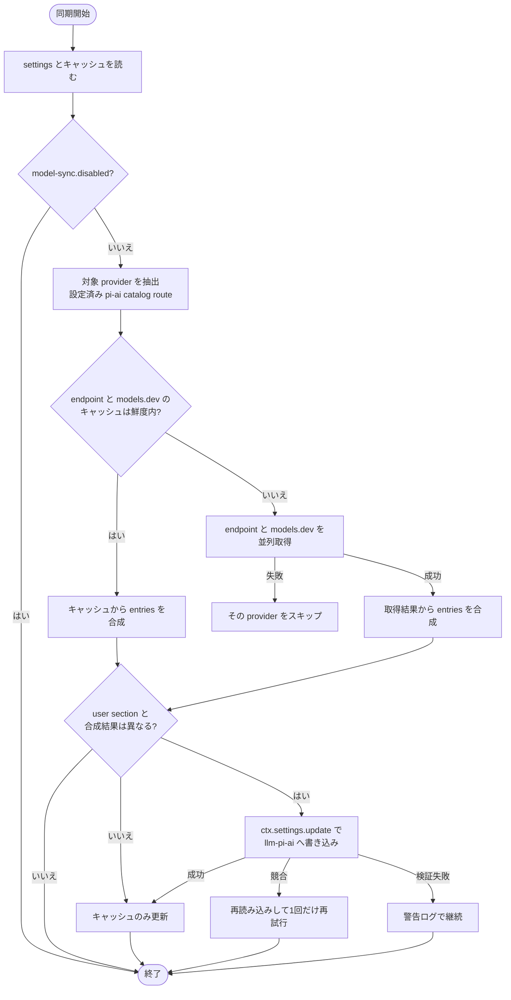

# model-sync plugin Spec

dsh webプロファイルで、設定済みの pi-ai catalog provider のモデル一覧を models.dev と provider の models endpoint から動的に取得し、settings の `llm-pi-ai:` セクションへ反映するdsh bundle plugin。

pi-ai の installed catalog は generated JSON で、新モデルはライブラリ更新まで `UNKNOWN_MODEL` になる。本plugin は models.dev等からの動的取得でこの遅延を緩和し、settings の `models` リスト更新として反映する。

## 同期の全体フロー



失敗時とキャッシュの詳細は「失敗時の扱い」「キャッシュ」で定める。

## 対象Provider

`llm-pi-ai.providers` に profile を持つroute のうち、次のすべてを満たすid。

- pi-ai の installed catalog（`@earendil-works/pi-ai/providers/all` の `getBuiltinProviders()`）に存在する
- wire protocol（`profile.api`、未設定なら installed catalog の共通api）が `openai-completions` / `openai-responses` / `anthropic-messages` のいずれか、または未確定（openai互換として扱う）
- `apiKeyEnv` が設定され、`ctx.credentials.resolve` で値に解決できる

hand-declared route（カタログ外id）は対象外。ユーザーが models を明示定義しており、models.dev の id も対応しないため。

wire非対応の catalog api（`google-generative-ai`、`bedrock-converse-stream` など）に解決されるroute も対象外で、`/model-sync` の結果行にも現れない。

`model-sync.disabled: true`（本plugin固有settings namespace）のときは同期もコマンドも何もしない。

## 同期の起点

| 起点 | 動作 |
| --- | --- |
| profile boot（plugin apply） | キャッシュを読み、鮮度内なら合成して直ちに反映する。endpoint または models.dev のキャッシュが無い、または 12時間より古い場合は、バックグラウンドで取得してから反映する |
| 12時間ごとの timer | 各取得時刻を判定し、古いものだけ再取得して反映する |
| `/model-sync` コマンド | キャッシュ鮮度にかかわらずnetwork同期を実行し、完了を待ってproviderごとに結果行を返す |

## ネットワーク取得

### models.dev

- `GET https://models.dev/api.json`（認証なし）
- provider id はそのまま（zai → `zai`）

### provider endpoint

endpoint URL と認証は route の wire protocol（`profile.api`、未設定なら installed catalog の共通api）で決める。

| protocol | URL | 認証ヘッダー |
| --- | --- | --- |
| `openai-completions` / `openai-responses` | `<baseURL>/models` | `Authorization: Bearer <key>` |
| `anthropic-messages` | `<baseURL>`（末尾 `/v1` を正規化）`/v1/models?limit=1000` | `x-api-key: <key>` ＋ `anthropic-version: 2023-06-01`。key が `sk-ant-oat` で始まる場合は代わりに `Authorization: Bearer` ＋ `anthropic-beta: oauth-2025-04-20` |

- `baseURL` は `profile.baseURL`、未設定なら installed catalog の当該provider の baseUrl。catalog内で baseUrl の綴りが混在するときは、URL path が最も深いものを選ぶ（例: openrouter は `…/api` と `…/api/v1` が混在するため `…/api/v1`）。URL path の深さが同じときは catalog の先頭を採用する
- API key は `profile.apiKeyEnv` を `ctx.credentials.resolve` で解決する。settings に `apiKeyEnv` が無い、解決できない、名前が reference文法に合わない、のいずれかの provider は endpoint を呼ばない（`no auth` 扱い）
- route profile の `headers`（`Record<string, string>`。文字列値のみ）をリクエストヘッダーへ先に設定する。同名の header は上表の認証ヘッダーが上書きする
- 1リクエストのタイムアウトは 15秒。応答本文は 10 MiB を超えたら失敗扱い。provider間は並列に実行する

## モデル一覧の抽出

| 応答形式 | 配列 | model ID | provider側メタデータ |
| --- | --- | --- | --- |
| OpenAI | `data[]` | `id` | OpenRouter のみ次節のフルセット、他は `name`（あれば） |
| Anthropic | `data[]` | `id` | `display_name`（表示名として使用） |

OpenRouter かどうかは route id が `openrouter` であることで判定する。`openrouter` 以外の route の OpenAI応答からは `name`（あれば）のみを取り出し、`supported_parameters` 等の OpenRouter形式の field は読まない。

### チャットモデルのフィルタ

抽出後、モデルID（小文字比較）に次の文字列を含むモデルを除外する。

```text
embed, whisper, tts, dall-e, gpt-image, imagen, sora, flux,
stable-diffusion, diffusion, moderation, guardrail, rerank,
babbage, davinci, transcribe, asr, ocr, speech
```

フィルタ後のモデルが 0件になったprovider は失敗扱いとし、反映をスキップする。

### OpenRouter の endpointメタデータ

`supported_parameters` に `reasoning` または `include_reasoning` が含まれるなら `reasoning`、`architecture.input_modalities` に `image` を含むなら `input: ["text","image"]`、`context_length` → `contextWindow`、`top_provider.max_completion_tokens` → `maxTokens`、`pricing`（per-token文字列を per-million数値へ変換し小数第4位で丸める。`prompt`→`input`、`completion`→`output`、`input_cache_read`→`cacheRead`、`input_cache_write`→`cacheWrite`）。

## エントリ合成

providerごとに、settings の `providers.<id>.models` に書くentry の配列を組み立てる。入力は次の 4つ。

- endpoint から抽出したremote のモデル一覧
- models.dev の当該provider のメタデータ（`models.<modelId>` の `name` / `reasoning` / `modalities.input` / `limit.context` / `limit.output`）
- pi-ai の installed catalog（`getBuiltinModels(provider)`。同名id の継承元と新規entry の既定に使う）
- settings の現在の user section の `models` 配列と、前回plugin が書いたentry（キャッシュの `written`）

### 各フィールドの値

entry には remote または models.dev由来の値があればそれを書く。installed catalog に同名id があり、新しい値が無いフィールドは**書かない**（catalog の値が継承される）。installed catalog に無いid（新規）は、新しい値が無いフィールドを既定値で書く。

| フィールド | 優先順 | 既定値（新規id のみ書く） |
| --- | --- | --- |
| `name` | endpoint の `name` ＞ models.dev の `name` ＞ catalog の `name` ＞ model ID | model ID |
| `contextWindow` | endpoint ＞ models.dev `limit.context` ＞ catalog | `128000` |
| `maxTokens` | endpoint ＞ models.dev `limit.output` ＞ catalog | `16384` |
| `input` | endpoint（OpenRouter）＞ models.dev `modalities.input`（`image` を含むなら `["text","image"]`）＞ catalog | `["text"]` |
| `reasoningEfforts` | 書かない（catalog の capability を継承）。新規id で models.dev の `reasoning: true` のときだけ、同provider の reasoning済みcatalog entry の `thinkingLevelMap` から `{level: wire}` を移植する | — |
| `api` | 書かない（catalog の共通api が継承される）。ただし catalog の api が混在していて新規id の場合のみ、先頭の catalog entry の api を書く | — |

`cost` / `compat` / `thinkingLevelMap` は settings の schema に書けない（同名id は catalog から継承、新規id は pi-ai の既定detection に任せる）。

### 所有権と追加・削除

- 現在の user `models` 配列の各entry について:
  - **plugin所有**（前回plugin が書いたentry と同一、または user `models` 配列自体が無い）→ 今回の合成entry で置き換える
  - **user所有**（上記以外）→ 値を保持し、更新も削除もしない
  - remote一覧に無いentry のうち、plugin所有かつinstalled catalog に無いid → 削除する（remote から消えた新規モデル）
  - それ以外の remote無きentry → 保持する（installed catalog由来の id は endpoint に列挙が無くても残す）
- remote にあってuser `models` に無いid → 末尾に追加する
- user `models` 配列が無いprovider では、installed catalog全id を対象に合成を開始する

## settings への書き込み

- 変更があったprovider だけを 1回の `ctx.settings.update('llm-pi-ai', { providers: { <id>: { models } } })` にまとめて書く。patch は object を再帰mergeし配列を置換するため、`apiKeyEnv` など他の field は保たれる
- `describe()` で得た `llm-pi-ai` の `revision` を `expectedRevision` に渡す。`SETTINGS_CONFLICT` が返ったらuser section を読み直して合成から 1回だけやり直す
- 書き込みの schema・serviceable検証は dsh側が行う。検証に失敗したらその provider の反映を諦めて警告ログを出し、他の処理は続行する

## キャッシュ

キャッシュは `$DSH_HOME/model-sync-cache.json`（`DSH_HOME` 未設定なら `~/.dsh/model-sync-cache.json`）に保存する。内容:

- `providers.<id>`: endpoint URL の baseUrl、取得時刻、抽出済みモデル一覧
- `modelsDev`: 取得時刻と providerメタデータ全体
- `written.<id>`: 前回settings に書き込んだentry の配列（所有権判定用）

endpoint と models.dev はそれぞれの取得時刻で鮮度（12時間）を判定する。更新に失敗したデータは上書きせず、次の同期で再試行する。`written` は settings書き込みに成功したprovider だけ更新する。キャッシュの書き込みは同じdirectory の一時ファイルを renameして原子的に行う。読み取り・検証に失敗したらキャッシュは無いものとして扱う。

## `/model-sync` コマンド

キャッシュ鮮度にかかわらずnetwork同期を実行して完了を待ち、providerごとに 1行ずつ結果を返す。

| 状態 | 行 |
| --- | --- |
| 成功 | `✓ <provider>: <モデル数> models (<新規数> new)` |
| 認証解決できずスキップ | `- <provider>: no auth` |
| 失敗 | `✗ <provider>: <エラーメッセージ>` |
| `model-sync.disabled` | `model-sync: disabled` で終了 |
| 対象provider なし | `model-sync: no configured pi-ai catalog providers` で終了 |

## 起動時・timer起点の表示

起動時・timer起点の同期は通知せず、失敗時のみhost の標準出力へ warning を出す。

## 失敗時の扱い

| 状況 | 扱い |
| --- | --- |
| provider の endpoint取得失敗（HTTPエラー・タイムアウト・JSONパース失敗・フィルタ後に 0件） | その provider の反映をスキップする。settings の既存内容とキャッシュは維持する |
| models.dev の取得失敗 | 同期を続行し、メタデータは models.devキャッシュ（期限切れも可）→ 既定値の順で補完する |
| settings書き込みの検証失敗 | 警告ログを出して継続する。`written` は更新しない |
| キャッシュの読み取り・検証失敗 | キャッシュは無いものとして扱い、network同期する |
| キャッシュの書き込み失敗 | settings への反映は維持する。警告ログを出す |
