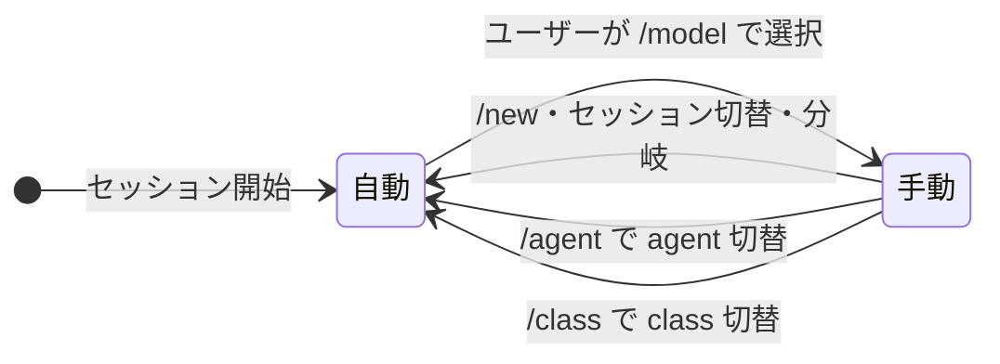
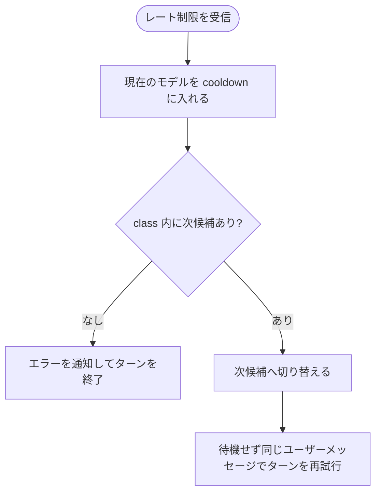
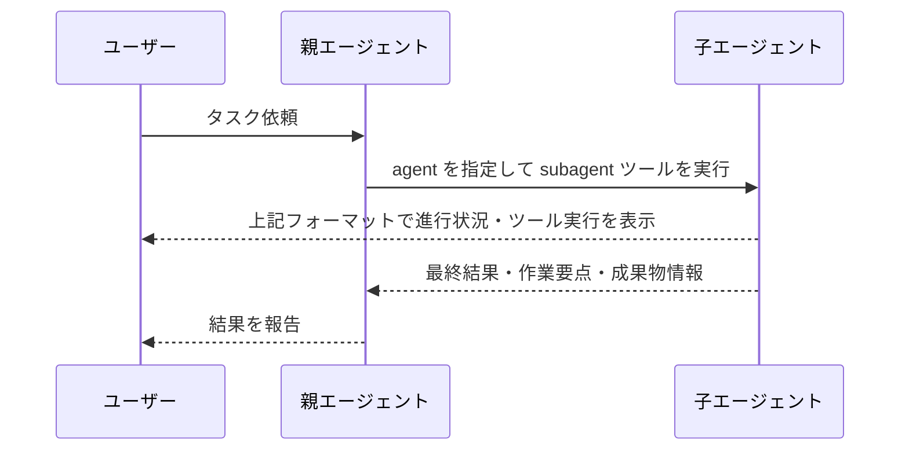

# Agent拡張機能Spec

## 概要

セッションは **agent** を実行する。agent は利用できるツール、依頼できる子agent、システムプロンプトを持ち、モデル候補の順序（class）の既定値を持つ実行主体である。本拡張は agent定義の管理と選択を行い、`/agent:<name>` コマンド・`--agent` フラグ・subagentツールの `agent` パラメータを提供する。class は `/class` コマンドと `--class` フラグで agent と独立に選択できる。

モデルの自動選択と切り替えはこの拡張だけが行う。ユーザーは `agents.yaml` で class と agent を管理し、`/agent:<agent>` で実行するagent を、`/class` でモデル候補の順序を切り替えられる。

## 設定

設定ファイル: `~/.pi/agent/config/agents.yaml`

```yaml
default: main

classes:
  high:
    - provider: <provider>
      model: <model>
      # 時間帯で候補の有効/無効を切り替える例（終了コード 0 のとき有効）
      when: "<bash command>"
    - provider: <provider>
      model: <model>
  middle:
    - provider: <provider>
      model: <model>
    - provider: <provider>
      model: <model>
  low:
    - provider: <provider>
      model: <model>
  vision:
    # 画像入力をサポートするモデルだけを置く
    - provider: <provider>
      model: <model>

agents:
  main:
    class: high
    tools: ["*"]
    subagents: [senior, junior, vision]
    systemPrompt: ["...", "..."]
  senior:
    class: middle
    tools: ["*", "!replace_context"]
    subagents: [junior, vision]
    systemPrompt: ["...", "..."]
  junior:
    class: low
    tools: ["*", "!replace_context"]
    subagents: []
    systemPrompt: ["..."]
  vision:
    class: vision
    tools: ["*", "!replace_context"]
    subagents: []
    # tools と systemPrompt は junior と同じ内容。class: vision のみが異なる
    systemPrompt: ["..."]
```

| 項目・操作 | 内容と振る舞い |
| --- | --- |
| 設定ファイル | 起動時に検証する。有効な場合は agent を利用でき、不正な場合はエラーを通知する（後述） |
| `default` | 新規セッションと保存済みセッションで開始するagent |
| `agents.<name>` | agent の定義 |
| `classes.<name>` | class のモデル候補の配列。配列の先頭から fallback順序として評価する |
| 候補の `provider` / `model` | 候補のモデル |
| 候補の `when` | bashコマンド。終了コード `0` のときだけ候補が有効になる。省略・空文字なら常に有効。5秒でタイムアウトし、タイムアウト・失敗時は無効 |
| `class` | agent の既定class。必須 |
| `tools` | pi標準ツールと拡張機能の allowlist。指定したツールを実行し、未指定のツールを拒否してセッションを継続する。`["*"]` はすべてのツール、`[]` はツールなしを許可する。`"!<tool-name>"` は `"*"` を含んでもそのツールを除外する。`["*", "!<tool-name>"]` は有効である。 |
| `subagents` | subagentツールでの起動を許可する子agent の一覧。定義済みの agent が一覧に含まれる場合は起動し、含まれない場合や一覧が空の場合は起動せずセッションを継続する |
| `systemPrompt` | 次回のエージェント実行時に、配列要素を記載順で結合して追記するagent固有のシステムプロンプト。YAML のアンカーとエイリアスで複数agent間で要素を共有できる |
| `/agent:<name> [message]` | 指定したagent を即時に有効にする。モデルは切替先agent の既定class の候補を適用し、ツール・agent表示も切り替える。`message` を続けた場合は agent切り替え完了後にそのテキスト（前後の空白を除く）をユーザーメッセージとして送信し、切替先agent の設定で直ちにターンを開始する。`message` を省略した場合は切り替えのみ行う |
| `/class [name]` | 実効class（後述）を `name` に切り替え、手動選択を解除し、切り替え先class の候補を適用する。`name` を省略した場合は選択UI で class を選ぶ。選択UI をキャンセルした場合は何も変更しない。UI を持たない環境で `name` を省略すると usageエラーを通知して何も変更しない。表示は「通知のない環境」の規定に従う。未定義の `name` は warning で通知し、何も変更しない。cooldown は維持する |
| `--class <name>` フラグ | 初期class（後述）を指定する。実効class はセッション開始・`/new`・セッション切替・分岐でこの class に初期化される。未定義の値は warning で通知し、無視する。`--agent` と独立であり併用できる |

## 設定の検証

拡張のロード時に設定ファイルを検証する。次のいずれかに該当する場合は `agents.yaml: <理由>` を throw して拡張のロードを失敗させ、pi は起動時の診断にロード失敗を表示する。不正な設定を一部分だけ適用することはなく、設定が有効な場合にだけ拡張のすべての機能（agent切替、ツール制限、subagent、モデルルーティング）を登録する。

- 設定ファイルがない・読めない・YAML として不正
- `default` か `agents` がない、型が違う
- `agents` の各定義がオブジェクトでない
- agent の `class` がない、文字列でない
- agent が `classes` に定義されていないclass を参照している
- `classes` がない・オブジェクトでない、class の値が配列でない
- 候補の `provider` か `model` がない・文字列でない、`when` が文字列でない
- `tools`・`subagents`・`systemPrompt` が配列でない、要素が文字列でない
- `tools` の否定指定が `!` だけ、または `"*"` 以外の同じツール名を許可と否定の両方で指定する
- `vision` がない、または `class` が `vision` でない
- main または senior の `subagents` が `vision` を含まない
- junior の `subagents` が `vision` を含む
- `default` が未定義の agent を指している
- `subagents` が未定義の agent を含む

## class によるモデル選択

class はデフォルトフォールバックの候補順序であり、モデルの種類による制限はしない。class の候補配列を先頭から順に評価し、最初に成立した候補を選ぶ。

モデル候補の選択に使うclass（実効class）は、`/class` で切り替えたclass を優先し、切り替えていないときは agent の `class` を既定値とする。実効class は agent の選択とは独立であり、画像入力対応を含むモデルの種類による制限をしない。

セッション開始・`/new`・セッション切替・分岐のタイミングでは、`--class` フラグで有効な class が指定されていれば実効class はその class になり、指定がなければ初期agent の既定class になる。これを初期class と呼ぶ。

| 候補の状態 | 扱い |
| --- | --- |
| モデルがモデルレジストリに存在しない | 除外して次へ |
| cooldown待機中（後述） | 除外して次へ |
| `when` が終了コード `0` を返さない | 除外して次へ |
| 上記いずれにも該当しない | その候補を選ぶ |

| 状態 | 結果 |
| --- | --- |
| 候補モデルの適用に失敗した（APIキーがないなど） | その候補を除外して次候補へ進む |
| class内の全候補が不成立、または全候補で適用に失敗 | 「モデルの適用タイミング」の該当行に従う |

class をまたいだ降格は行わない。

## モデルの適用タイミング

| タイミング | 動作 |
| --- | --- |
| セッション開始 | 初期agent（`--agent` フラグで指定された定義済みの agent、指定なしまたは未定義なら `default`）の初期class の候補を適用する |
| `/new` | 手動選択を解除し、cooldown をすべて破棄し、初期class の候補を適用する |
| セッション切替・分岐（`/resume`・`/fork`） | 手動選択を解除し、実効class を初期class に戻し、その候補を適用する |
| `/reload` | 設定を読み込み直す。手動選択状態・実効class・cooldown は維持する。保存済みagent・class が reload後の設定に存在しない場合は、agent は初期agent へ、class は agent の既定class へ戻す |
| 各プロンプト送信前（自動状態のとき） | 現在の実効class の候補を再評価し、現在のモデルと異なる候補が成立したら切り替える。全候補が不成立の場合はエラーを通知し、プロンプトを実行しない |
| `/agent:<name>` | agent を切り替え、手動選択を解除し、実効class を切替先agent の既定class に戻してその候補を適用してから後続メッセージを送信する |
| `/class [name]` | 実効class を切り替え、手動選択を解除し、切り替え先class の候補を適用する |
| 429受信時 | 「レート制限（429）時のフォールバック」に従う |

モデルの切り替えに成功したら `agent model → <provider>/<model>` を info で通知する。

| 全候補が不成立になる場面 | 結果 |
| --- | --- |
| セッション開始・`/new`・セッション切替・分岐・`/agent:<name>`・`/class` | 現在のモデルを維持し、`no available model for agent <name>: class <class-name>` を warning で通知する |
| プロンプト送信前 | `no available model for agent <name>: class <class-name>` を error で通知し、プロンプトを実行しない |
| 429受信時 | 「レート制限（429）時のフォールバック」に従う |

## 手動モデル選択



| 状態 | 振る舞い |
| --- | --- |
| 自動 | 各プロンプト送信前に実効class の候補を再評価する |
| 手動 | ユーザーが選んだモデルを使い続ける。プロンプト送信前の再評価を行わない |

状態を変える操作とその時の全動作は「モデルの適用タイミング」の表が定め、この図は手動状態の遷移だけを示す。手動状態中の 429フォールバック後も手動状態を維持する。

`/model` による手動選択は、active agent とモデルの画像入力対応に関わらず、すべてのモデルを受け入れる。

## レート制限（429）時のフォールバック

次のいずれかを受けたモデルは cooldown（待機状態）に入る。ただし、HTTP 429 によるフォールバックに成功した後は、同じターンの後続HTTP 429 では追加の cooldown・モデル切替を行わず、フォールバック先を維持する。この HTTP 429 の抑止はセッション開始または拡張由来でない入力で初期化し、拡張由来の入力と 429以外の HTTPレスポンスでは維持する。

| 入力 | レート制限として扱う条件 | 待機期間 |
| --- | --- | --- |
| HTTPレスポンス | status が `429`（z-aiモデルを除く、下記の例外） | `Retry-After` ヘッダーに従う |
| 最終assistantエラー | `stopReason` が `error` で、`errorMessage` が「レート制限エラーパターン」に一致する（下表） | 30分 |

**z-aiモデルの例外**: Z.AI は 429 の body に同時実行系（`1302`/`1305`）と quota系（`1113`、`1308`〜`1321`）の両方を返し、HTTPレスポンスだけでは区別できない。そこで z-aiモデルは HTTPレスポンスでは fallbackせず、最終assistantエラーの文言判定に委ねる。最終assistantエラーのうち同時実行系は `concurrency-retry` 拡張が待機リトライするためfallback対象外、quota系は従来どおり本spec の fallback に従う（判定経路が最終assistantエラーのみのため、cooldown待機期間は 30分固定）。判定は `shared/zai-concurrency.ts` の共有判定を使う。

HTTPレスポンスの `Retry-After` は次のように解釈する。

| `Retry-After` の内容 | 待機期間 |
| --- | --- |
| 秒数 | その秒数 |
| HTTP-date | その日時までの残り時間 |
| ない・解釈不能 | 30分 |

### レート制限エラーパターン

HTTP 429 はステータスコードで判定するため全プロバイダ共通。最終assistantエラーは pi-ai が文字列化するため、プロバイダファミリごとの文言を大文字小文字を区別せず部分一致で判定する。一過性の障害（5xx、`overloaded`、`service unavailable`、タイムアウト等）は含めず、pi本体の再試行に任せる。

パターンの一覧の正本は実装（`routing.ts` の `RATE_LIMIT_ERROR_PATTERNS`）が持つ。本spec は一覧を転記しない。パターンの追加・変更は実装側で行うが、判定方法（大文字小文字を区別しない部分一致）と、一過性の障害を含めない方針はこの節の規定に従う。

除外: z-aiモデルの同時実行系エラー（`1302`/`1305`、判定は `shared/zai-concurrency.ts` の `isZaiConcurrencyLimited`）は、文言がこのパターンに一致しても fallback を行わない。担当は `concurrency-retry` 拡張（`concurrency-retry/SPEC.md`）。



- 手動状態でも同じ流れでフォールバックする。
- 次候補への切替後、Pi は追加の待機を入れず、現在のユーザーメッセージを追加せずにターンを再試行する。ユーザーメッセージの履歴件数は増えない。
- HTTP 429 によるフォールバックを伴わず、最終assistantエラーの文言判定だけでフォールバックする場合、現在の実効class の候補数を N とすると、1ターンで最大N-1回再試行し、最大N候補を順に試行する。再試行回数は `~/.pi/agent/settings.json` の `retry.maxRetries`（候補数以上を推奨）が上限となる
- フォールバックで切り替えに成功したら `rate limited on <provider>/<model>; switched to <provider>/<model>` を warning で通知する。
- フォールバックに成功した場合、レート制限エラーとなった最終assistantメッセージのエラー文言を、フォールバック済みであることを示す置換文言へ差し替えてから再試行する。置換後の文言には元のエラー文言を含めない。quota・課金系の文言（`insufficient_quota` 等）が残ったまま再試行されると、pi本体がそのメッセージを再試行不可と判定してターンがエラー終了するためである。
- 次候補がない場合は `rate limited on <provider>/<model>; no fallback available` を error で通知し、再試行しない。この通知には元のエラー文言と、ユーザーによるメッセージ再送を促す案内を含める。

### フォールバック済みターンのエラー判定

HTTP 429 によるフォールバック後、同じターンの最終assistantエラーでは追加の cooldown を行わない。pi本体は失敗メッセージの `provider` / `model` を失敗処理時点のセッションモデルで記録するため、メッセージの provider は 429 を受けたモデルとは限らず、provider だけで fallback対象を同定できないためである。

HTTP 429 を受けてフォールバックした直後から、次のいずれかまでを「フォールバック済みターン」として扱う。

| 事象 | 抑止（二重フォールバックの抑止）の扱い |
| --- | --- |
| 最終assistantエラーの `provider` / `model` が 429 を受けたモデルと一致 | 抑止を消費して処理する |
| 最終assistantエラーの文言が「レート制限エラーパターン」に一致 | 抑止を消費して処理する。provider が 429 を受けたモデルと不一致でも同様（付け替えられた失敗メッセージの可能性があるため） |
| 429以外の HTTPレスポンス（フォールバック先で次のリクエストが飛んだ） | 抑止を解除する。以降の最終assistantエラーは、下記の誤帰属の例外を除き `provider` / `model` ベースの通常判定に戻る |
| 上記以外の最終assistantエラー | 何もせず、抑止を維持する |

抑止を消費したときの処理は、429受信時点でのフォールバックの可否で決める。cooldown の主体はメッセージの `provider` / `model` ではなく、429 を受けたモデルを使う。

| フォールバックの可否 | 処理 |
| --- | --- |
| 切替成功 | 最終assistantエラーの文言を「フォールバック済みの置換文言」へ差し替える。追加の通知はしない |
| 次候補なし | 429 を受けたモデルを主体に `rate limited on <provider>/<model>; no fallback available` を error で通知する |

通常判定では、同じターンに HTTP 429 を受けたモデルのプロバイダ固有のレート制限文言が別モデルの最終assistantエラーへ引き継がれた場合、その別モデルを cooldown に入れず、エラー文言だけを「フォールバック済みの置換文言」へ差し替える。追加の通知・モデル切替は行わない。

この例外は、メッセージのモデル自身が同じターンに HTTP 429 を受けておらず、文言が「レート制限エラーパターン」に一致し、次の固有文言に一致するHTTP 429 の受信モデルが一意に定まる場合に適用する。

| HTTP 429 の受信プロバイダ | 固有文言 |
| --- | --- |
| `amazon-bedrock` | `throttling error`・`too many tokens per day`・`ThrottlingException`（大文字小文字を区別しない部分一致） |
| `zai` / `z-ai` | `code"\s*:\s*"(1310\|1113)"` の正規表現に一致 |

汎用的な usage limit文言だけではこの例外を適用しない。HTTP 429 の受信モデルの記録は z-aiモデルを除き、セッション開始と拡張由来でない入力で初期化する。拡張由来の入力と 429以外の HTTPレスポンスでは保持する。

### pi の再試行設定

429フォールバックでは Pi の agent-level retry を使い、provider-level retry は使わない。`~/.pi/agent/settings.json` には次を設定する。

```json
{
  "retry": {
    "enabled": true,
    "maxRetries": 5,
    "baseDelayMs": 0,
    "provider": {
      "maxRetries": 0
    }
  }
}
```

「レート制限エラーパターン」に一致する最終assistantエラーは、次候補への切替後に待機せず再試行する。

### cooldown（待機状態）

| 状況 | 結果 |
| --- | --- |
| 待機期間中のモデルが候補になる | 除外して次候補を探す |
| 待機期間の終了 | そのモデルを再び候補にする |

cooldown の破棄・維持は、発生タイミングごとに「モデルの適用タイミング」の表が定める。

## 画像入力を使うagent

モデルレジストリの `Model.input` が `"image"` を含むモデルを画像入力対応、含まないモデルを画像非対応とする。

`vision` class には画像入力対応モデルだけを置く。`vision` agent は `tools` と `systemPrompt` を `junior` と同じ内容に保つagent であり、`class: vision` のみが異なる。この同一性は設定検証で強制しない運用規約であり、`junior` と異なる `tools`・`systemPrompt` でも設定検証は成功する。`vision` の役割は、画像入力非対応モデルで動くagent から画像の読み取りを委譲される受け皿である。

`read` は画像ファイルを現在のモデルへの Vision入力として返す。現在のモデルの画像入力対応による振る舞いは sandboxed-tools の spec が定める。画像入力非対応モデルで動くagent は、画像の読み取りを `vision` 子agent へ委譲する。画像を OCRテキストへ変換する処理は行わない。

手動選択の受け入れは「手動モデル選択」節が定める。いずれの agent も、画像非対応モデルを選択している状態では画像入力を作れない。

| 現在のモデル | 画像を必要とする場合の振る舞い |
| --- | --- |
| 画像入力対応 | `read` で画像を読み、そのまま作業を完了する |
| 画像入力非対応 | `vision` を子agent として起動し、画像と依頼を渡す。親には子の最終テキストと成果物だけを返す |

チャット貼り付けと CLI の `@file` で画像が入力された場合、active agent のモデルが画像入力対応なら、画像をそのセッションのモデルへそのまま入力する。画像非対応なら、画像をモデルへ送らず、画像を含む子セッションを `vision` として起動し、親へ返すのは子の最終テキストと成果物だけとする。`vision` を起動できないagent で画像が入力された場合は、画像をモデルへ送らずエラーを通知する。

画像を処理できるモデルがない場合（`vision` への委譲が class候補の不成立で失敗した場合や、`vision` が画像非対応モデルを選択している場合を含む）は、画像を画像非対応モデルへ送るフォールバックを行わず、画像を処理できないエラーを返す。

この機能の目的は、画像入力非対応モデルへ画像を送らないことである。ファイルシステム・ツール出力・セッション保存先を横断した画像データの機密性を保証する機能ではない。

## Agent表示

セッション開始時と agent・class の切り替え時に、現在の agent と実効class を表示する。

```text
🤖 agent: <currentAgent>
💎 class: <class-name>
```

class が未選択のときは agent行のみを表示する。手動状態のときは `💎 class: <class-name> (manual)` のように class行の末尾に `(manual)` を付ける。表示のテキスト色はグレーとする。

## 通知のない環境

UI を持たない環境（`--mode json`、パイプ、SDK、subagent の子セッション）では通知を表示しない。モデルルーティング・フォールバック・再送は同じように動作する。ただしプロンプト送信前の全候補不成立でプロンプトを実行しないときは、エラーメッセージを stderr へ出力し、プロセスの終了コードを 1 にする。

## subagentツール

subagentツールは常に利用できる。子セッションを起動できるかは、現在の agent の `subagents` で決まる。

subagentツールは子セッションを起動するとき `--agent <name>` と保存先の `--session-dir <dir>` を渡し、モデルと `--class` を指定しない。子セッションの実効class は指定されたagent の既定class から始まり、候補を選んで適用する。子セッションでもこの spec のモデルルーティング（自動選択、429フォールバック）が同じように働く。

### subagentツールの入力

| パラメータ | 必須 | 内容 |
| --- | --- | --- |
| `task` | 必須 | 子エージェントへ渡すタスク |
| `agent` | 必須 | `agents.yaml` に定義された子agent名 |
| `cwd` | 任意 | 子エージェントの作業ディレクトリ。省略時は親と同じ |
| `model` | 使用不可 | モデルは指定した子agent の既定class から解決される |

subagentツールで起動した子エージェントには、指定されたagent の設定が適用される。子エージェントの `default` は適用されない。子エージェントは自身の `subagents` に従って、さらに subagentツールを実行できる。

| 設定 | 子セッションへの適用 |
| --- | --- |
| スキル自動発見 | 親と同じルール |
| モデル | 指定された子agent の既定class から、子セッションが解決する |
| ツール | 指定された子agent の `tools` |
| システムプロンプト | 指定された子agent の `systemPrompt` を追記 |
| さらなるsubagent実行 | 子エージェントの `subagents` で判定 |

### 子セッションのセッション記録

子の履歴の正本は、子pi自身が保存する独立したJSONLファイルである。subagentツールと画像入力の自動vision委譲に同じ保存・参照規則を適用する。

| 項目 | 振る舞い |
| --- | --- |
| 保存先 | `<getAgentDir()>/sessions/<cwd識別子>/subagents/`。実際の子cwdを絶対パスに解決し、先頭の `/` または `\` を除き、残りの `/`・`\`・`:` を `-` に置換して `--` で前後を囲んだものをcwd識別子とする |
| 子の起動引数 | `--session-dir <保存先>` を指定し、通常の新規セッションとして起動する。`--no-session`・既存セッションを指定する引数は渡さない |
| 子の識別 | piが生成するUUIDと時刻によるファイル名を使う。同じagent・taskの並行実行や拡張のreloadをまたぐ実行でも独立する |
| 親の記録 | `customType: agents.subagent-session` の `custom` entry に参照メタデータだけを記録する。全履歴・reasoning・usageの複製は含めない |
| 共通フィールド | `data.invocationId`・`source`・`agent`・`task`・`cwd`・`sessionDir`・`phase`。`source` は `subagent` または `image`。`invocationId` はsubagentツールのtoolCallId、自動vision委譲では呼び出しごとのUUID |
| 子header受信時 | `phase: start` を1件記録する。headerの `id` を `sessionId` とし、headerの `timestamp` の `:`・`.` を `-` に置換した値とIDから `<timestamp>_<id>.jsonl` を組み立て `sessionFile` とする。このパスは実ファイル作成前の予定パスであり、存在を保証しない |
| 子終了時 | 成功・失敗・abort・stallに関わらず `phase: end` を1件記録する。同じ `invocationId` と取得済みの `sessionId`・`sessionFile` を使い、`exitCode`・取得できた `stopReason`・`errorMessage` と、終了時にファイルが存在するかの `sessionFileExists` を含める |
| header前の失敗 | `end` に保存先を残し、未取得の `sessionId`・`sessionFile` は省略し、`sessionFileExists` は `false` とする。起動していない待機中abortでは参照entryを作らない |
| コンテキストと最終報告 | 参照の `custom` entry はLLMコンテキストに参加しない。subagentツールの最終報告とUI、画像委譲の報告は既存の経路で返す |

親が終了記録前に停止しても、保存済みの開始参照と子JSONLは独立して残る。親自身が未保存の場合の耐久性は親の保存状態に従う。子JSONLの作成時機はpiの通常保存に従い、header受信後でも最初の会話メッセージ保存前にはファイルが存在しない場合がある。子headerへの親リンクの追記は行わない。保存済みの `agents.subagent-log` entryを含む過去ログは、そのまま保持する。

### 同時実行数の制限

親セッションあたり、同時に実行する子セッションは2つまでとする。

| 実行中の子 | 新しいsubagentツールの呼び出し |
| --- | --- |
| 2つ未満 | すぐに子セッションを起動する |
| 2つ | 実行中の子が終了して空きが出るまで待機し、先に待機した呼び出しから順に起動する |

待機中の呼び出しは、ツールの結果欄に `(waiting for a free subagent slot...)` を表示する。待機中に親がキャンセルした場合、その呼び出しはエラーとして終了する。

### 子の stdout の読み取りと表示更新の間引き

子pi は `--mode json` で起動し、stdout の JSONイベントを親が読み取る。子は stdout への書き込みが読み取られない間（バックプレッシャー）は agent loop の進行を止めるため、親は子の実行中ずっと stdout を読み続けなければならない。

表示の更新（onUpdate の送出）はレンダリングを同期実行する重処理になり得る。子が bash等で大量のイベントを短時間に流したとき、イベントごとに表示を更新すると親のイベントループがレンダリングで占有され、stdout の読み取りが止まり、子の agent loop も停止する。これを防ぐため、イベントの受領・記録は毎回行い、onUpdate の送出は 0.15秒に 1回までに間引く。

## subagent実行中の表示フォーマット

subagent の呼び出し時と実行結果を、次の形式で表示する。実行結果は subagentツールの結果欄に子エージェントごとの実行ブロックとして表示する。折りたたみは行わない。子からのイベント（`message_end`・ツール実行の開始・更新・終了）は毎回受領して記録する一方、表示の更新は 0.15秒に1回までに間引き、間引き中のイベントは最新の状態に併合する。子の実行確定時には必ず最新状態で更新する。

### 呼び出し時の表示

```text
subagent <child-agent>
```

### 実行結果の表示形式

```text
┌─── Task ──────
<task>
└───────────────

┌─── Actions ───
<actions>
└───────────────

┌─── Output ────
<output>
└───────────────
```

| 項目 | 形式・条件 |
| --- | --- |
| `child-agent` | 実行した子agent名 |
| `task` | subagentツールに渡したタスク全文 |
| `<actions>` | 子エージェントがツールを利用した場合のみ、受け取った時系列順ですべて表示する |
| `<output>` | 最終アシスタントテキストが確定した場合のみMarkdown として表示する |
| 待機行 | 子エージェントの実行が確定するまでブロックの末尾に表示する（後述） |
| 更新 | 子からのイベントは毎回受領・記録し、表示は 0.15秒に1回まで間引く。間引き中のイベントは最新の状態に併合する。子の実行確定時には必ず最新状態で更新する |

### Actions の行形式

ツール呼び出しは「コール行」と、その下の「結果行」で構成する。コール行はツールごとに整形した表示、結果行はツールの実行結果のサマリーとする。

| ツール | コール行 | 結果行（成功時） |
| --- | --- | --- |
| `bash` | `→ $ <command>`（300文字で切り詰め） | 実行秒数（例: `1.2s`）。計測できないときは `done` |
| `write` | `→ write <path>` | `wrote <size>` |
| `edit` | `→ edit <path>` | `edited N block(s)` |
| `read` | `→ read <path>`（SKILL.md のとき `[skill] <name>`） | `N lines` |
| `grep` | `→ grep <pattern>` | `N matches` |
| `find` | `→ find <pattern>` | `N files` |
| `ls` | `→ ls <path>`（未指定は `.`） | `N entries` |
| 上記以外のツール | `→ <toolName> <args-preview>`。引数は JSON の先頭100文字までを表示し、超過時は `...` を付ける。引数がない場合は `{}` と表示する | 表示しない |

結果行はコール行の下に半角スペース2文字分のインデントを付けて表示する。

| 条件 | 結果行の内容 |
| --- | --- |
| ツールがエラーを返したとき | エラーメッセージの末尾を優先して最大2000文字。超過時は末尾に `[Output truncated; showing the tail.]` を付ける |
| ツールの結果を受け取る前 | 表示しない |

### 待機スピナー

subagent の呼び出しを受け付けた直後から子エージェントの実行が確定するまで、ブロックの末尾に待機行を表示する。

```text
<frame> <child-agent>
```

| 項目 | 振る舞い |
| --- | --- |
| フレーム | titlebar と同じ `⠋` `⠙` `⠹` `⠸` `⠼` `⠴` `⠦` `⠧` `⠇` `⠏` の 10文字をこの順で循環させる |
| 切り替え | 80ミリ秒間隔でフレーム文字を切り替える。行を増やさず同じ位置で更新する。間隔は titlebar と共通の `SPINNER_INTERVAL_MS`（pi-tui の Loader と同じ80ミリ秒）を使う |
| テキスト色 | セクション区切りと同じグレー系とする |
| 消去 | 子エージェントの実行が確定した時点で待機行を消す |

subagent完了時に親エージェントへ渡すのは、最終結果・作業要点・成果物情報であり、子の中間ログは親へ渡さない。



## 実行できない場合の報告

エージェントがタスクを遂行できない場合は、理由（権限不足、力量・情報不足など）を添えて報告する。報告先（subagent実行中は依頼元エージェント、直接実行時はユーザー）の指定は拡張コードで強制せず、各agent の systemPrompt の規範に委ねる。

## 停止

| 状況 | 動作 |
| --- | --- |
| 親がキャンセル | 子セッションへ停止を伝播する |
| 子の停止 | SIGTERM を送信し、5秒後も停止しなければ SIGKILL を送信する |
| 無進捗タイムアウト | 子の stdout から parse可能な JSONイベントを最後に受信してから 15分間、新たなイベントがなければ子を停止し、subagentツールの結果をエラーとして親へ返す。tool実行中（`tool_execution_start` 受信から対応する `tool_execution_end` 受信まで）は計測しない。ツールの実行時間はツール側の時間管理に任せる。停止理由は `stalled`、エラーメッセージは `Child stalled: no child events for 15 min` とする |
| 子の異常終了 | 子プロセスの終了コードが 0以外、シグナルによる終了、子がエラーで停止した場合、または終了コード0 で最終アシスタントテキストが空の場合、subagentツールの結果をエラーとして親へ返す。結果は `Child <停止理由 \| failed>: <出力>`の形式で、出力は子のエラーメッセージ・stderr・最終アシスタントテキストの順に採用し、末尾を優先して最大2000文字にする。超過時は末尾に `[Output truncated; showing the tail.]` を付ける。いずれもなければ`(no output)`とする。シグナルによる終了の停止理由は`killed`、エラーメッセージは `Child process was killed by a signal` とする |
| 子終了後の残留出力 | 子プロセスの終了後も標準出力・標準エラーへの書き込みが続く間は読み取りを続け、最後の書き込みから 0.1秒途切れた時点で結果を確定する。ストリームが閉じた場合は直ちに確定する |
