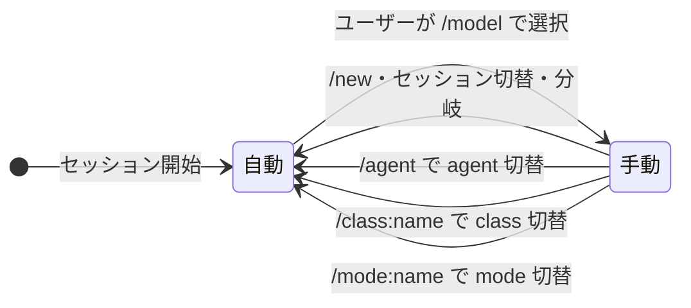

# モデル選択Spec

mode・classによる候補選択、usageによる採点、モデル適用と手動選択を定める。読者は利用者と実装・テストの担当者。agent・class・modeの用語と設定は [agent管理](agent-management.spec.md) に従う。

## mode の選択

モデル候補の取得には実効mode の `modes.<mode>.<実効class>` だけを使う。全modeが同じclass名集合を持ち、候補・順序・重み・settings はmodeごとに指定する。`vision` も同じ規則に従う。

初期mode は次の優先順で決める。セッション開始・`/new`・セッション切替・分岐では、この初期modeへ戻す。

| 優先順 | 入力 | 結果 |
| --- | --- | --- |
| 1 | `--max` が true、かつ `max` が定義済み | `max` |
| 2 | 内部環境変数 `PI_AGENT_MODE` が定義済みmode名 | そのmode |
| 3 | 上記以外 | `defaultMode` |

`--max` に対応する `max` が未定義の場合は warning で通知し、その指定を無視して次の優先順へ進む。未定義の継承modeも無視する。pi本体の `--mode text/json/rpc` は出力形式の指定であり、agent のmodeとは独立して扱う。

mode変更とクラス変更イベントは受信順に適用し、それぞれモデル適用完了を待つ。mode切替はagent の tools・subagents・systemPrompt を維持する。mode の適用処理が完了したら `agent mode → <name>` を info で通知する。

## class によるモデル選択

class はモデル候補の配列であり、モデルの種類による制限はしない。ハードフィルタを通った候補をusageスコア順に並べ、先頭から順に適用する。

モデル候補の選択に使うclass（実効class）は、`/class:<name>` で切り替えたclass を優先し、切り替えていないときは agent の `class` を既定値とする。実効class は agent の選択とは独立であり、画像入力対応を含むモデルの種類による制限をしない。

セッション開始・`/new`・セッション切替・分岐のタイミングでは、`--class` フラグで有効な class が指定されていれば実効class はその class になり、指定がなければ初期agent の既定class になる。これを初期class と呼ぶ。

| 候補の状態 | 扱い |
| --- | --- |
| 候補の `<LATEST>` が解決できない（レジストリに一致する版がない） | その解決から除外して次へ。次の解決で再試行する |
| モデルがモデルレジストリに存在しない | 除外して次へ |
| cooldown待機中（[待機状態](rate-limit.spec.md#cooldown待機状態)） | 除外して次へ |
| 上記いずれにも該当しない | 生存候補とする |

解決1回につき `<LATEST>` の解決とハードフィルタを1回評価し、候補が1件でも「usage スコアリングによる候補の並べ替え」に従って採点し、最終スコア0の候補を除外する。候補の適用に失敗しても同じ配列の次へ進み、再照会・再ソートはしない。次のプロンプトや429による別の解決では再評価する。

| 状態 | 結果 |
| --- | --- |
| 候補モデルの適用に失敗した（APIキーがないなど） | その候補を除外して次候補へ進む |
| class内の全候補が不成立、または全候補で適用に失敗 | 「モデルの適用タイミング」の該当行に従う |

mode・class をまたいだ降格は行わない。この規則は候補選択の自動評価に適用され、`recontext` による明示的なクラス指定には適用しない。

## 補助推論向けのclassモデル解決

補助推論でも、開始時点の実効modeと指定classで通常の候補選択を使う。候補順に認証情報を確認し、解決できる先頭のモデルを使う。現在のモデルを保持する最適化は適用せず、親セッションのモデル・実効class・思考設定・手動選択状態を維持する。

## usage スコアリングによる候補の並べ替え

レート制限後のフォールバックでも、直前のモデルが手動選択かどうかにかかわらず、同じ候補選択の規則を適用する。

class のハードフィルタを通った生存候補のうち、`usage --json` で `short` が `0` の provider の候補を採点前に除外する。`short` が正または不明の provider の候補は、`long` 枠から算出する urgency に従ってスコア順に並べ替える。CLI の入出力は `dotfiles/.agents/cli.exact/usage/SPEC.md` に従い、urgency の算出は拡張が担う。policy の解釈・並べ替え、モデルへのリクエスト、レート制限・cooldown の管理は拡張が担う。

通常のセッションルーティングと補助推論のusage照会は、拡張が決めた固定補助処理として通常のプロセス起動で `usage --json` を実行する。候補や設定ファイルを引数へ渡さず、stdoutとstderrを分離する。呼び出し元の中断信号を伝え、開始済みプロセスの終端を待つ。解決1回につき各候補のスコアを1回だけ計算し、降順に安定ソートする。同点は設定の配列順を維持し、CLIの出力順は順序の判断に使わない。同一 provider/model の重複候補も、それぞれの `weight` と `settings` で独立にスコア付けする。

スコアの計算式は「settings ルール（provider設定・cron・名前空間multiply）」が定める。候補別settingsを適用した最終スコアが0の候補は選択対象から除外する。同一モデルの重複候補は独立に判定し、0でないスコアの候補が残ればそのモデルを選択できる。

| 項目 | 挙動 |
| --- | --- |
| 利用状況の取得 | 生存候補が1件以上なら解決ごとに照会する。キャッシュや別の予熱は行わない |
| CLI 不在（起動時のENOENT・終了コード127）・出力不正 | セッション内で以後のCLI照会を無効化する。urgencyを不明として、数値weight・multiply・cronによる採点と0除外を続ける |
| 全provider照会失敗（終了コード1） | 全providerのurgencyを不明として、数値weight・multiplyによる採点を続ける |
| その他のCLI実行失敗・中断・タイムアウト | その解決だけurgencyを不明として採点し、0除外を続ける。以後の照会は無効化しない。CLI実行の上限は25秒 |
| CLIのstderr診断 | stdoutのJSONと分離し、有効な配列の適用を妨げない |
| 適用に失敗した候補 | 取得した同じ配列の次候補へ進む。再照会はしない |

## settings ルール（provider設定・cron・名前空間multiply）

ルールは「倍率」であり、候補のスコアは次の形になる。暗黙の倍率はなく、ルールとして書いたときだけ掛かる。

```text
score = (weight ?? 1) × 有効ルールの multiply₁ × multiply₂ × …
```

ルールの適用対象は3段階で決まる。候補の `settings` がある場合はそれを使い、その provider の `settings.<provider>` 設定は使わない（継承・マージではない置換）。候補の `settings` がなく provider設定がある場合は provider設定を使う。どちらもない場合はルールなし（×1）である。

```yaml
settings:
  zai:
    - multiply: zai.urgency
    - cron: "* 6-9 * * 1-5"
      multiply: 0
  deepseek:
    - cron: "* 1-3 * * 1-5"
      multiply: 0

defaultMode: standard
modes:
  standard:
    high:
      - model: zai/glm-5.3
      - model: zai/glm-5.3-flash
        settings:
          - multiply: zai.urgency
```

ルールは2種類である。どちらも `multiply` は非負の有限数（0・0.5・1.5 などを許す）、または `<provider>.urgency` 形式の名前空間参照である。

| ルール | 有効条件 | multiply |
| --- | --- | --- |
| `{multiply: <値>}` | 常に有効 | 数値はそのまま、名前空間参照は該当providerのurgency |
| `{cron: <式>, multiply: <値>}` | 現在時刻（UTC）が cron 式にマッチする間だけ有効 | 同上 |

### 名前空間multiply

`<provider>.urgency` は、最後の `.` で provider 部分と field 部分に分割し、field は `urgency` のみを認める（それ以外は設定エラー）。provider 部分は usage JSON の `provider` と完全一致で照合し、その行の `long`・`longResetsAt`・`longWindowMinutes` から拡張内部で算出するurgencyを倍率に使う。参照先providerの候補の有無には依存せず、自己参照と別provider参照を同じように扱う。参照するprovider名は設定の `multiply` で指定する。

算出式は `resetRate = max((resetMs - nowMs) / 60000, 60) / longWindowMinutes`、`urgency = (long / 100) / resetRate**2.5` とする。`resetMs` は `longResetsAt` をepochミリ秒へ変換した値、`nowMs` は拡張が採点する時点の現在時刻である。リセットまでの残り時間は60分を下限とし、resetRateとurgencyの丸めは行わない。

| 入力の状態 | 扱い |
| --- | --- |
| JSON全体が配列でない、各行の `provider` が非空文字列でない、または `long` が有限数値でも `null` でもない | 出力不正 |
| `longResetsAt` が `null` でもパース可能なオフセット付き時刻文字列（`Z` または `±HH:mm`）でもない | 出力不正 |
| `longWindowMinutes` が `null` でも正の有限数値でもない | 出力不正 |
| 参照先provider行がない、または `long`・`longResetsAt`・`longWindowMinutes` のいずれかが `null` | urgency 不明として1を掛け、候補は保持する |
| リセット済み（`resetMs ≤ nowMs`）、現在時刻が非有限、または算出結果が非有限 | urgency 不明として1を掛け、候補は保持する |
| 有効な期間・未来のリセット日時があり、残量が0 | urgency は0。最終スコア0の除外規則に従う |

算出では、パース不能な日時と非正・非有限の期間もurgency不明として扱う。CLI JSONにこれらが含まれる場合は、上表の出力不正の規則を適用する。

### cron 式

標準の5フィールド構文（分 時 日 月 曜日）で、UTC の現在時刻で評価する。分・時・日・月・曜日の全フィールドがマッチする瞬間のみルールが有効である。各フィールドで使える項目は次のとおり。名前（`JAN`・`SUN`）とマクロ（`@daily`）は拒否する。

| 項目 | 意味 |
| --- | --- |
| `*` | フィールドの全範囲 |
| 数値 | その値だけ |
| `a-b` | a 以上 b 以下の範囲（両端を含む） |
| `a,b,c` | リスト。各要素は上記のいずれか |
| `*/n` | フィールド最小値から n Step ごと |
| `a-b/n` | a から b まで n Step ごと |

| フィールド | 範囲 |
| --- | --- |
| 分 | 0〜59 |
| 時 | 0〜23 |
| 日 | 1〜31 |
| 月 | 1〜12 |
| 曜日 | 0〜7（7 は 0 と同じ日曜） |

範囲の下限が上限より大きい式、フィールド範囲外の値、フィールド数が5でない式は設定エラーである。曜日の 0 と 7 の同値扱い以外に特殊規則は作らない（日と曜日の OR 合成などもしない）。

| 項目 | 挙動 |
| --- | --- |
| 複数のルール | すべて評価し、有効なルールの `multiply` を乗算する |
| cron非マッチのルール | そのルールは無効（×1） |
| ルールなし | 補正なし（×1）。候補は重みだけのスコアになる |
| 名前空間参照・urgency 不明 | 1 を掛ける。候補は保持する |
| 候補・ルールの未知キー、負や無限の `multiply`、不正な cron 式 | 設定検証で失敗させる |
| 候補から参照されない provider の設定 | 許可する |
| スコア0の候補 | 「usage スコアリングによる候補の並べ替え」の除外規則に従う |

## <LATEST> トークンの解決

候補の model 部分には `<LATEST>` トークンを含められる（`zai/glm-<LATEST>`、`openai-codex/gpt-<LATEST>-sol` など）。トークンはルーティング時（候補のハードフィルタの前）に解決し、解決1回につき1回だけ行う。解決済みの候補はそのまま既存の候補フロー（レジストリ検索・cooldown・スコアリング）を通る。

解決は、テンプレートの `<LATEST>` を `\d+(?:\.\d+)*` に置いた正規表現で、同providerのレジストリ全chatモデルの id に完全一致照合し、捕まえた版文字列を比較して最大のものを採用。版の比較は `.` 区切りの数値セグメント比較（数値として比較）で、全セグメントが等しい場合はセグメント数が多い方を大きいとする（`5.3.1` > `5.3`、`5.10` > `5.9`）。

一致する版が1件もない候補は、その解決では利用不可として除外する（レジストリに存在しない候補と同じ扱い）。次の解決で再試行するため、レジストリが更新されれば使えるようになる。

## クラス変更イベント

この節は、クラス変更を要求する拡張の実装者向けの契約である。

実行中の明示的なクラス変更は `agents:class-change` の受信処理だけが行う。`/class:<name>`・`/agent:<name>` による既定classへの切替も、外部拡張と同じ `requestClassChange(events, options)` を使う。セッション初期化・復元はこの要求経路とは別に行う。候補再評価・429フォールバックはclass自体を変更しない。

イベント契約とヘルパーは `agents/class-change.ts` に置く。要求の入力は次のとおり。

| 入力 | 意味 |
| --- | --- |
| `class` | クラス名。`undefined` は現在のagentの既定classへ戻す |
| `context` | 呼出し元の現在の `ExtensionContext` |
| `source` | 選択主体の表示。`manual`・`auto`・`agent`。省略時は `agent`。ユーザーのコマンドは `manual` を指定する |
| `preserveManualSelection` | `true` のとき手動モデル選択を維持し、変更を無視してwarning通知する。同じ実効classへの要求も再適用しない。省略時は手動選択を解除して候補を適用する |
| `requiredAgent` | 指定時は現在のagentがこの名前の場合だけ適用する |

受信処理は要求を受けた順に処理する。実効class更新・手動選択の扱い・モデル適用・表示更新を担当し、適用処理のPromiseを `respond` で同期的に返す。呼出し元はヘルパーのPromiseをawaitし、モデル適用処理が完了するまで後続処理へ進まない。

結果は `applied`（適用処理完了）、`unchanged`（同じclass）、`ignored`（条件不成立・未定義class・中断済み）、`unavailable`（受信拡張なし）である。候補不成立時の通知とモデル維持は下表に従う。`applied` は適用処理の完了を示し、利用可能なモデルの存在は保証しない。例外は呼出し元へ伝わり、後続要求の処理は継続できる。受信拡張がなければ無期限に待たず `unavailable` を返す。

## 自動選択モデルの60分維持

通常のプロンプト送信前の再評価では、スコア0の除外を含む候補評価の後に、次の順でモデルを決める。維持期間はproviderや候補によらず共通の60分とする。

| 再評価時の状態 | 結果 |
| --- | --- |
| 現在のモデルが有効な候補に残り、そのモデルの最後の呼び出しから60分未満 | 他候補の順位が上がっても現在のモデルを維持する |
| 現在のモデルが候補から外れた、呼び出し履歴がない、または最後の呼び出しから60分以上 | 有効な候補をスコア順に適用する |
| 有効な候補がない | 「モデルの適用タイミング」の全候補不成立の規則に従う |

最後の呼び出しは実provider応答の開始時刻とし、ツール実行後の継続を含め、応答の開始または正常な完了を確認できた呼び出しで更新する。モデルの選択や、応答開始を確認できないエラー・中断だけでは更新しない。429後に別モデル名で合成されたエラーは、その別モデルの呼び出しとして扱わない。

`/reload` では呼び出し時刻を維持する。セッション開始・切替・分岐・同一セッションのツリー移動では、有効なブランチの履歴だけから復元する。履歴のエラー・中断メッセージ単独では実呼び出しを確認できないため、復元の根拠にしない。

ピーク時間帯のcronなどで現在の候補がスコア0になれば、60分未満でも次のプロンプト送信前に別候補へ切り替える。画像付き入力も、モデルへ送信またはvisionへ委譲する前にこの候補評価を行う。拡張由来の後続入力では現在モデルが有効なら維持し、有効でなければ選び直す。全候補0による停止は、これらの入力にも適用する。

明示的なagent・class・modelの変更、セッション初期化時の候補適用、429フォールバックは、この維持判定を通さず各節の規則に従う。

## モデルの適用タイミング

| タイミング | 動作 |
| --- | --- |
| セッション開始 | 初期agent（`--agent` フラグで指定された定義済みの agent、指定なしまたは未定義なら `default`）の初期mode・初期class の候補を適用する |
| `/new` | 手動選択を解除し、cooldown をすべて破棄し、初期mode・初期class の候補を適用する |
| セッション切替・分岐（`/resume`・`/fork`） | 手動選択を解除し、実効mode・実効class を初期mode・初期class に戻し、その候補を適用する |
| `/reload` | 設定を読み込み直す。手動選択状態・選択主体表示・実効mode・実効class・cooldown・現在のモデルは維持し、モデルの再適用は行わない。保存済みagent・mode・class が reload後の設定に存在しない場合は、agent は初期agent へ、mode は `defaultMode` へ、class は agent の既定class へ戻す |
| 各プロンプト送信前（自動状態のとき） | 現在の実効mode・実効class の候補を再評価し、「自動選択モデルの60分維持」に従って維持または切替を行う。全候補が不成立の場合はエラーを通知し、プロンプトを実行しない |
| `/agent:<name>` | 実効mode を維持してagent を切り替え、手動選択を解除し、実効class を切替先agent の既定class に戻してその候補を適用してから後続メッセージを送信する |
| `/class:<name>` | agent・実効mode・cooldown を維持して実効class を `name` に切り替え、手動モデル選択を解除し、切り替え先class の候補を適用する |
| `/mode:<name>` | agent・実効class・cooldown を維持して実効mode を `name` に切り替え、手動モデル選択を解除し、同じ実効class の候補を適用して完了を通知する。同じmodeの再指定でも再適用する |
| コンテキスト切替（`recontext` で `class` 指定あり、実効modeの変更なし） | 実効mode を維持し、切替条件の確認後、同じクラス変更イベントへ要求し、適用完了を待ってから自動続行する。最初の続行ターンから指定クラスを使う。`preserveManualSelection: true`・`requiredAgent: "main"` とし、手動選択・同じclass・未定義class・main以外は変更しない |
| コンテキスト切替（`recontext` で Max に切替） | [Max 指定](../recontext/SPEC.md#recontext-ツールの-max-指定)に従う |
| 429受信時 | [レート制限（429）時のフォールバック](rate-limit.spec.md#レート制限429時のフォールバック)に従う |

モデルの切り替えに成功したら `agent model → <provider>/<model>` を info で通知する。

| 全候補が不成立になる場面 | 結果 |
| --- | --- |
| セッション開始・`/new`・セッション切替・分岐・`/agent:<name>`・`/class:<name>`・`/mode:<name>`・クラス変更イベント | 現在のモデルを維持し、`no available model for agent <name>: class <class-name>` を warning で通知する |
| プロンプト送信前 | `no available model for agent <name>: class <class-name>` を error で通知し、プロンプトを実行しない |
| 429受信時 | [レート制限（429）時のフォールバック](rate-limit.spec.md#レート制限429時のフォールバック)に従う |

## 手動モデル選択



| 状態 | 振る舞い |
| --- | --- |
| 自動 | 各プロンプト送信前に実効class の候補を再評価する |
| 手動 | ユーザーが選んだモデルを使い続ける。プロンプト送信前の再評価を行わない |
| 手動中のクラス指定（`recontext` の `class`、実効modeの変更なし） | クラスを変更せず、`class change to <class> ignored: manual model selection is active` を warning で通知する |

状態を変える操作とその時の全動作は「モデルの適用タイミング」の表が定め、この図は手動状態の遷移だけを示す。手動状態中の 429フォールバック後も手動状態を維持する。

`/model` による手動選択は、active agent とモデルの画像入力対応に関わらず、すべてのモデルを受け入れる。

## 通知のない環境

UI を持たない環境（`--mode json`、パイプ、SDK、subagent の子セッション）では通知を表示しない。モデルルーティング・フォールバック・再送は同じように動作する。ただしプロンプト送信前の全候補不成立でプロンプトを実行しないときは、エラーメッセージを stderr へ出力し、プロセスの終了コードを 1 にする。
