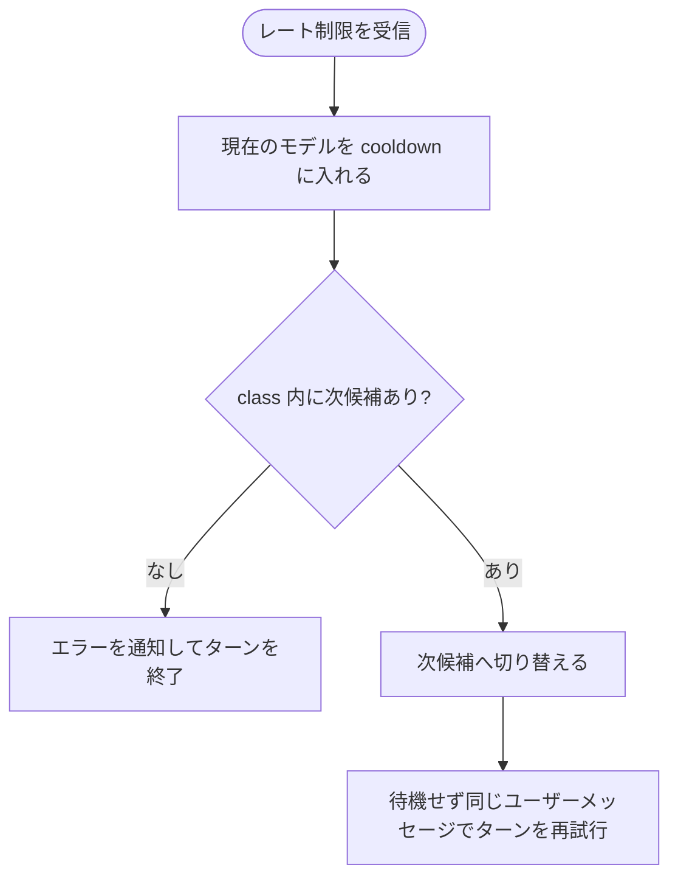

# レート制限時の再試行Spec

レート制限の判定、モデルの待機状態、フォールバックと再試行を定める。読者は利用者と実装・テストの担当者。候補選択と適用タイミングは [モデル選択](model-routing.spec.md) に従う。

## レート制限（429）時のフォールバック

次のいずれかを受けたモデルは cooldown（待機状態）に入る。ただし、HTTP 429 によるフォールバックに成功した後は、同じターンの後続HTTP 429 では追加の cooldown・モデル切替を行わず、フォールバック先を維持する。この HTTP 429 の抑止はセッション開始または拡張由来でない入力で初期化し、拡張由来の入力と 429以外の HTTPレスポンスでは維持する。

| 入力 | レート制限として扱う条件 | 待機期間 |
| --- | --- | --- |
| HTTPレスポンス | status が `429`（z-aiモデルを除く、下記の例外） | `Retry-After` ヘッダーに従う |
| 最終assistantエラー | `stopReason` が `error` で、`errorMessage` が「レート制限エラーパターン」に一致する（下表） | 30分 |

**z-aiモデルの例外**: Z.AI は 429 の body に同時実行系（`1302`/`1305`）と quota系（`1113`、`1308`〜`1321`）の両方を返し、HTTPレスポンスだけでは区別できない。そこで z-aiモデルは HTTPレスポンスでは fallbackせず、最終assistantエラーの文言判定に委ねる。最終assistantエラーのうち同時実行系は `provider-error-retry` 拡張が待機リトライするためfallback対象外、quota系は従来どおり本spec の fallback に従う（判定経路が最終assistantエラーのみのため、cooldown待機期間は 30分固定）。判定は `shared/zai-concurrency.ts` の共有判定を使う。

HTTPレスポンスの `Retry-After` は次のように解釈する。

| `Retry-After` の内容 | 待機期間 |
| --- | --- |
| 秒数 | その秒数 |
| HTTP-date | その日時までの残り時間 |
| ない・解釈不能 | 30分 |

### レート制限エラーパターン

HTTP 429 はステータスコードで判定するため全プロバイダ共通。最終assistantエラーは pi-ai が文字列化するため、プロバイダファミリごとの文言を大文字小文字を区別せず部分一致で判定する。一過性の障害（5xx、`overloaded`、`service unavailable`、タイムアウト等）は含めず、pi本体の再試行に任せる。

パターンの一覧の正本は実装（`routing.ts` の `RATE_LIMIT_ERROR_PATTERNS`）が持つ。本spec は一覧を転記しない。パターンの追加・変更は実装側で行うが、判定方法（大文字小文字を区別しない部分一致）と、一過性の障害を含めない方針はこの節の規定に従う。

除外: z-aiモデルの同時実行系エラー（`1302`/`1305`、判定は `shared/zai-concurrency.ts` の `isZaiConcurrencyLimited`）は、文言がこのパターンに一致しても fallback を行わない。担当は `provider-error-retry` 拡張（`provider-error-retry/SPEC.md`）。



- 手動状態でも同じ流れでフォールバックする。
- 次候補への切替後、Pi は追加の待機を入れず、現在のユーザーメッセージを追加せずにターンを再試行する。ユーザーメッセージの履歴件数は増えない。
- HTTP 429 によるフォールバックを伴わず、最終assistantエラーの文言判定だけでフォールバックする場合、現在の実効class の候補数を N とすると、1ターンで最大N-1回再試行し、最大N候補を順に試行する。再試行回数は `~/.pi/agent/settings.json` の `retry.maxRetries`（候補数以上を推奨）が上限となる
- フォールバックで切り替えに成功したら `rate limited on <provider>/<model>; switched to <provider>/<model>` を warning で通知する。
- フォールバックに成功した場合、レート制限エラーとなった最終assistantメッセージのエラー文言を、フォールバック済みであることを示す置換文言へ差し替えてから再試行する。置換後の文言には元のエラー文言を含めない。quota・課金系の文言（`insufficient_quota` 等）が残ったまま再試行されると、pi本体がそのメッセージを再試行不可と判定してターンがエラー終了するためである。
- 次候補がない場合は `rate limited on <provider>/<model>; no fallback available` を error で通知し、再試行しない。この通知には元のエラー文言と、ユーザーによるメッセージ再送を促す案内を含める。

### フォールバック済みターンのエラー判定

HTTP 429 によるフォールバック後、同じターンの最終assistantエラーでは追加の cooldown を行わない。pi本体は失敗メッセージの `provider` / `model` を失敗処理時点のセッションモデルで記録するため、メッセージの provider は 429 を受けたモデルとは限らず、provider だけで fallback対象を同定できないためである。

HTTP 429 を受けてフォールバックした直後から、次のいずれかまでを「フォールバック済みターン」として扱う。

| 事象 | 抑止（二重フォールバックの抑止）の扱い |
| --- | --- |
| 最終assistantエラーの `provider` / `model` が 429 を受けたモデルと一致 | 抑止を消費して処理する |
| 最終assistantエラーの文言が「レート制限エラーパターン」に一致 | 抑止を消費して処理する。provider が 429 を受けたモデルと不一致でも同様（付け替えられた失敗メッセージの可能性があるため） |
| 429以外の HTTPレスポンス（フォールバック先で次のリクエストが飛んだ） | 抑止を解除する。以降の最終assistantエラーは、下記の誤帰属の例外を除き `provider` / `model` ベースの通常判定に戻る |
| 上記以外の最終assistantエラー | 何もせず、抑止を維持する |

抑止を消費したときの処理は、429受信時点でのフォールバックの可否で決める。cooldown の主体はメッセージの `provider` / `model` ではなく、429 を受けたモデルを使う。

| フォールバックの可否 | 処理 |
| --- | --- |
| 切替成功 | 最終assistantエラーの文言を「フォールバック済みの置換文言」へ差し替える。追加の通知はしない |
| 次候補なし | 429 を受けたモデルを主体に `rate limited on <provider>/<model>; no fallback available` を error で通知する |

通常判定では、同じターンに HTTP 429 を受けたモデルのプロバイダ固有のレート制限文言が別モデルの最終assistantエラーへ引き継がれた場合、その別モデルを cooldown に入れず、エラー文言だけを「フォールバック済みの置換文言」へ差し替える。追加の通知・モデル切替は行わない。

この例外は、メッセージのモデル自身が同じターンに HTTP 429 を受けておらず、文言が「レート制限エラーパターン」に一致し、次の固有文言に一致するHTTP 429 の受信モデルが一意に定まる場合に適用する。

| HTTP 429 の受信プロバイダ | 固有文言 |
| --- | --- |
| `amazon-bedrock` | `throttling error`・`too many tokens per day`・`ThrottlingException`（大文字小文字を区別しない部分一致） |
| `zai` / `z-ai` | `code"\s*:\s*"(1310\|1113)"` の正規表現に一致 |

汎用的な usage limit文言だけではこの例外を適用しない。HTTP 429 の受信モデルの記録は z-aiモデルを除き、セッション開始と拡張由来でない入力で初期化する。拡張由来の入力と 429以外の HTTPレスポンスでは保持する。

### セッション記録

既存の判定・切替箇所から、非コンテキストcustom entry `agents-rate-limit` をbest-effortで保存する。保存例外は記録処理内で吸収し、既存の戻り値・元の例外・モデル選択・abort・通知を維持する。記録失敗の追加通知や例外本文の保存は行わず、記録の完全性は保証しない。`event` と保存内容は次のとおり。

| 観測点 | `event` | 保存する事実 |
| --- | --- | --- |
| HTTP 429 を観測 | `http_429` | 実HTTP値 `status: 429`、観測時の `modelKey`（モデル不明時はnull）、`decision`（`fallback` / `defer_zai` / `already_switched` / `missing_model`） |
| cooldownを設定してfallbackを開始 | `fallback_started` | `source`（`http_response` / `assistant_error`）、`rateLimitedModelKey`、`cooldownMs`、`cooldownUntil` |
| fallback処理を終了 | `fallback_finished` | 同じ `source`・元モデル、`switchedTo`（切替先またはnull）、`outcome`（`switched` / `unavailable` / `failed`） |
| 最終assistantエラーを判定 | `assistant_error` | メッセージの `messageModelKey`、`classification`（`zai_concurrency` / `rate_limit_pattern` / `other`）、`decision`（`concurrency_retry` / `http_fallback_applied` / `http_no_fallback` / `awaiting_http_message` / `misattributed_http_429` / `fallback`）。`other` はHTTP 429後の最終エラー待ち中に、rate-limit文言に一致しない場合だけ記録する。元モデルと一致する場合は抑止を消費し、不一致の場合は抑止を維持する。HTTP待ちでない通常の対象外エラーは記録しない |
| fallback済みの置換文言へ変換 | `retryable_rewrite` | `messageModelKey`、元の429モデルとして判定した `rateLimitedModelKey`、`source`（`http_response` / `assistant_error`） |

HTTP応答経路だけが実HTTP statusを持つ。最終assistantエラーの `classification` は既存の文字列判定による推定であり、実HTTP statusとは扱わない。HTTP由来の最終エラー処理では `rateLimitedModelKey` も保存し、メッセージのモデルと区別する。既存の誤帰属防止判定を維持する。

置換前は固定分類・構造化事実だけを記録し、生のerrorMessage、会話、payload、headers、URL、metadata、認証情報、自由文の失敗理由は複製しない。`fallback_finished` はモデル選択APIの結果、`retryable_rewrite` は変換の事実であり、本体の再試行の実行・成功を示さない。

### pi の再試行設定

429フォールバックでは Pi の agent-level retry を使い、provider-level retry は使わない。`~/.pi/agent/settings.json` には次を設定する。

```json
{
  "retry": {
    "enabled": true,
    "maxRetries": 5,
    "baseDelayMs": 0,
    "provider": {
      "maxRetries": 0
    }
  }
}
```

「レート制限エラーパターン」に一致する最終assistantエラーは、次候補への切替後に待機せず再試行する。

### cooldown（待機状態）

| 状況 | 結果 |
| --- | --- |
| 待機期間中のモデルが候補になる | 除外して次候補を探す |
| 待機期間の終了 | そのモデルを再び候補にする |

cooldown は provider/model を単位にmode間で共有する。同じモデルの待機状態はmode切替でも維持する。

cooldown の破棄・維持は、発生タイミングごとに[モデルの適用タイミング](model-routing.spec.md#モデルの適用タイミング)の表が定める。
