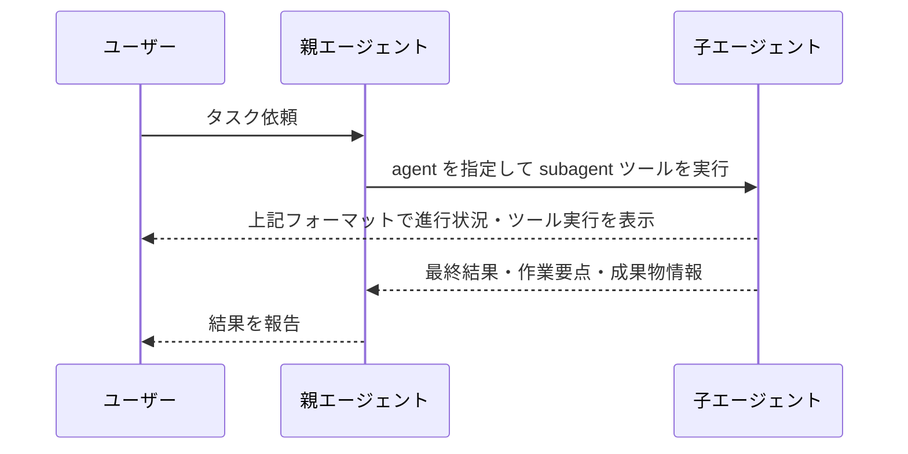

# subagentツールSpec

子セッションの起動、引継ぎ・フォーク、保存・報告と停止を定める。読者は利用者と実装・テストの担当者。agent定義は [agent管理](agent-management.spec.md) に従う。

## subagentツール

subagentツールは常に利用できる。子セッションを起動できるかは、現在の agent の `subagents` で決まる。

subagentツールは子セッションを起動するとき `--agent <name>` と保存先の `--session-dir <dir>` を渡し、モデルと `--class` を指定しない。既存の子セッションを引き継ぐときは `--session <path>` を、フォークするときは `--fork <path>` を渡す。親は呼出し開始時の実効mode を、slot待機より前に捕捉し、子の環境変数 `PI_AGENT_MODE` へ渡す。新規・resume・forkと自動vision委譲に同じ継承を適用する。子セッションは継承modeと指定agent の既定class から候補を選んで適用する。起動済みの子へ親の後続mode変更は配信しない。子セッションでも[モデル選択](model-routing.spec.md) と [レート制限時の再試行](rate-limit.spec.md)（自動選択、429フォールバック）が同じように働く。

### subagentツールの入力

| パラメータ | 必須 | 内容 |
| --- | --- | --- |
| `task` | 必須 | 子エージェントへ渡すタスク。resume・fork時は継続した履歴への追加指示 |
| `agent` | 必須 | `agents.yaml` に定義された子agent名 |
| `cwd` | 任意 | 子エージェントの作業ディレクトリ。省略時は親と同じ |
| `session` | 任意 | 引き継ぐ子セッションのセッションID またはセッションファイルの絶対パス。省略時は新規セッション |
| `fork` | 任意 | `true` のとき `session` の複製を新しい子セッションとして起動する。`session` の指定が必須 |
| `model` | 使用不可 | モデルは指定した子agent の既定class から解決される |

subagentツールで起動した子エージェントには、指定されたagent の設定が適用される。子エージェントの `default` は適用されない。子エージェントは自身の `subagents` に従って、さらに subagentツールを実行できる。

| 設定 | 子セッションへの適用 |
| --- | --- |
| スキル自動発見 | 親と同じルール |
| mode | 呼出し開始時の親の実効mode |
| モデル | 継承modeと指定された子agent の既定class から、子セッションが解決する |
| ツール | 指定された子agent の `tools` |
| システムプロンプト | 指定された子agent の `systemPrompt` を追記 |
| さらなるsubagent実行 | 子エージェントの `subagents` で判定 |

### セッションの引継ぎとフォーク

`session` を指定すると、新規セッションの代わりに既存の子セッションを引き継ぐ。`session` と `fork: true` の組み合わせでは、既存セッションを複製した新しい子セッションで起動する。`fork: true` に `session` がない呼び出しは、子を起動せずエラーを返す。

| 項目 | 振る舞い |
| --- | --- |
| 解決の対象 | 子の実効cwd（`cwd` パラメータ、省略時は親のcwd）の subagents 保存先配下に限る。配下外のパス・解決できないID は、子を起動せずエラーを返す |
| 指定子の解決 | 絶対パスは実在の `.jsonl` ファイルとして扱い、配下と存在を確認する。それ以外はセッションID として扱い、保存先内の `<timestamp>_<id>.jsonl` の `id` と照合する。完全一致を優先し、前方一致が1件のときだけ採用する。不在・複数一致はエラー |
| 子の起動 | 解決済みの絶対パスを `--session <path>`（resume）または `--fork <path>`（fork）で渡す |
| 履歴と参照 | resume・fork時も `task` は必須で、継続した履歴への追加指示として子に渡す。forkで作られた新しいセッションファイルは、子header受信時の参照記録で追跡する |
| 並行resumeの競合 | 同じセッションに対する並行resumeは、履歴を混在させ得る。親は排他制御をしない |

### 子セッションのセッション記録

子の履歴の正本は、子pi自身が保存する独立したJSONLファイルである。subagentツールと画像入力の自動vision委譲に同じ保存・参照規則を適用する。

| 項目 | 振る舞い |
| --- | --- |
| 保存先 | `<getAgentDir()>/sessions/<cwd識別子>/subagents/`。実際の子cwdを絶対パスに解決し、先頭の `/` または `\` を除き、残りの `/`・`\`・`:` を `-` に置換して `--` で前後を囲んだものをcwd識別子とする |
| 子の起動引数 | `--session-dir <保存先>` を指定し、通常の新規セッションとして起動する。resume・fork時はさらに `--session <path>` または `--fork <path>` を渡す。`--no-session` は渡さない |
| 子の識別 | piが生成するUUIDと時刻によるファイル名を使う。同じagent・taskの並行実行や拡張のreloadをまたぐ実行でも独立する |
| 親の記録 | `customType: agents.subagent-session` の `custom` entry に参照メタデータだけを記録する。全履歴・reasoning・usageの複製は含めない |
| 共通フィールド | `data.invocationId`・`source`・`agent`・`task`・`cwd`・`sessionDir`・`mode`・`phase`。`source` は `subagent` または `image`。`mode` は `new`・`resume`・`fork`。resume・fork時は `resumedFrom` に解決済みのセッションファイルパスを含める。`invocationId` はsubagentツールのtoolCallId、自動vision委譲では呼び出しごとのUUID |
| 子header受信時 | `phase: start` を1件記録する。headerの `id` を `sessionId` とし、headerの `timestamp` の `:`・`.` を `-` に置換した値とIDから `<timestamp>_<id>.jsonl` を組み立て `sessionFile` とする。このパスは実ファイル作成前の予定パスであり、存在を保証しない |
| 子終了時 | 成功・失敗・abort・stallに関わらず `phase: end` を1件記録する。同じ `invocationId` と取得済みの `sessionId`・`sessionFile` を使い、`exitCode`・取得できた `stopReason`・`errorMessage` と、終了時にファイルが存在するかの `sessionFileExists` を含める |
| header前の失敗 | `end` に保存先を残し、未取得の `sessionId`・`sessionFile` は省略し、`sessionFileExists` は `false` とする。起動していない待機中abortでは参照entryを作らない |
| コンテキストと最終報告 | 参照の `custom` entry はLLMコンテキストに参加しない。subagentツールの最終報告は、成功・失敗を問わず子のsessionId を取得できていれば `session: <sessionId>` を末尾に添えて返し、後続の呼び出しがそのID を `session` に指定できるようにする。UIと画像委譲の報告は既存の経路で返す |

親が終了記録前に停止しても、保存済みの開始参照と子JSONLは独立して残る。親自身が未保存の場合の耐久性は親の保存状態に従う。子JSONLの作成時機はpiの通常保存に従い、header受信後でも最初の会話メッセージ保存前にはファイルが存在しない場合がある。子headerへの親リンクの追記は行わない。保存済みの `agents.subagent-log` entryを含む過去ログは、そのまま保持する。

### 同時実行数の制限

親セッションあたり、同時に実行する子セッションは2つまでとする。

| 実行中の子 | 新しいsubagentツールの呼び出し |
| --- | --- |
| 2つ未満 | すぐに子セッションを起動する |
| 2つ | 実行中の子が終了して空きが出るまで待機し、先に待機した呼び出しから順に起動する |

待機中の呼び出しは、ツールの結果欄に `(waiting for a free subagent slot...)` を表示する。待機中に親がキャンセルした場合、その呼び出しはエラーとして終了する。

### 子の stdout の読み取りと表示更新の間引き

子pi は `--mode json` で起動し、stdout の JSONイベントを親が読み取る。子は stdout への書き込みが読み取られない間（バックプレッシャー）は agent loop の進行を止めるため、親は子の実行中ずっと stdout を読み続けなければならない。

表示の更新（onUpdate の送出）はレンダリングを同期実行する重処理になり得る。子が bash等で大量のイベントを短時間に流したとき、イベントごとに表示を更新すると親のイベントループがレンダリングで占有され、stdout の読み取りが止まり、子の agent loop も停止する。これを防ぐため、イベントの受領・記録は毎回行い、onUpdate の送出は 0.15秒に 1回までに間引く。

## subagent実行中の表示フォーマット

呼び出し行、結果ブロック（Task / Actions / Output / session行）、Actions の行形式、待機スピナーの表示は chat-renderer 拡張が担う。表示形式の正本は [chat-renderer仕様](../chat-renderer/SPEC.md#subagent) を参照。本拡張は子エージェントのイベントの受領・記録と、onUpdate 送出の間引き（0.15秒に1回）を担う。

subagent完了時に親エージェントへ渡すのは、最終結果・作業要点・成果物情報であり、子の中間ログは親へ渡さない。

## 停止

| 状況 | 動作 |
| --- | --- |
| 親がキャンセル | 子セッションへ停止を伝播する |
| 子の停止 | SIGTERM を送信し、5秒後も停止しなければ SIGKILL を送信する |
| 無進捗タイムアウト | 子の stdout から parse可能な JSONイベントを最後に受信してから 15分間、新たなイベントがなければ子を停止し、subagentツールの結果をエラーとして親へ返す。tool実行中（`tool_execution_start` 受信から対応する `tool_execution_end` 受信まで）は計測しない。ツールの実行時間はツール側の時間管理に任せる。停止理由は `stalled`、エラーメッセージは `Child stalled: no child events for 15 min` とする |
| 子の異常終了 | 子プロセスの終了コードが 0以外、シグナルによる終了、子がエラーで停止した場合、または終了コード0 で最終アシスタントテキストが空の場合、subagentツールの結果をエラーとして親へ返す。結果は `Child <停止理由 \| failed>: <出力>`の形式で、出力は子のエラーメッセージ・stderr・最終アシスタントテキストの順に採用し、末尾を優先して最大2000文字にする。超過時は末尾に `[Output truncated; showing the tail.]` を付ける。いずれもなければ`(no output)`とする。シグナルによる終了の停止理由は`killed`、エラーメッセージは `Child process was killed by a signal` とする |
| 子終了後の残留出力 | 子プロセスの終了後も標準出力・標準エラーへの書き込みが続く間は読み取りを続け、最後の書き込みから 0.1秒途切れた時点で結果を確定する。ストリームが閉じた場合は直ちに確定する |
