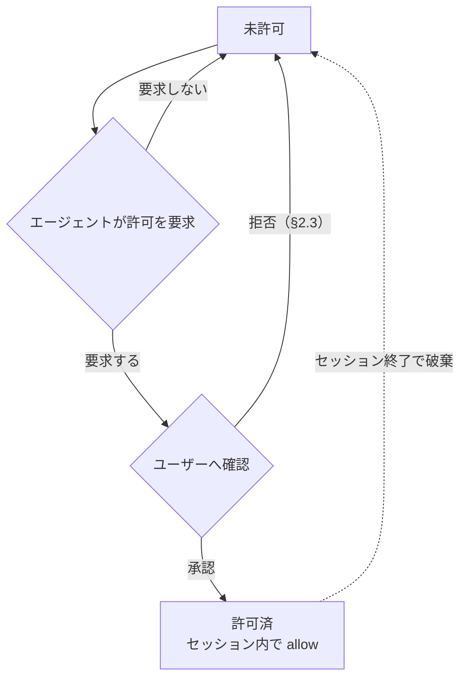

# guardrail — 仕様書

pi の全built-in fsツール（read / write / edit / grep / find / ls / bash）を置き換え、**パスの読み書きを `allow` / `deny` / `ask` で、bashコマンドを `allow` / `deny` / `ask` / `ask_with_reason` で制限**しつつ、network系は自由に使う拡張機能。

---

## 1. ツールごとの扱い

| piツール | 本拡張での扱い | fs読み書き制限 | network |
| --- | --- | --- | --- |
| `read` `write` `edit` `grep` `find` `ls` | 置き換え | あり | — |
| `bash` | 置き換え | あり | 開放 |
| LLM API / piプロセス本体 | 対象外 | — | 開放 |
| `ask_permission` | 追加 | あり | — |
| `codemode` | 登録のみ。結果表示の変更は tool-renderer 拡張（§8） | 呼び出したツールに従う | 呼び出したツールに従う |

置き換え対象は pi の **全built-in fsツール**（`read` `write` `edit` `grep` `find` `ls` `bash`）。`read` は画像ファイルを Vision入力として返す（§2.1）。

---

## 2. パスのアクセス結果（通常の fsツール共通）

read / write の各操作ごとに、対応する設定セクションからパスのアクション（`allow` / `deny` / `ask`）を解決し（§3）、結果が決まる。edit は対象パスに対してread と write の両方を確認する。許可された画像ファイルの `read` は §2.1 に従う。`credentials` に指定されたパスは §2.2 の例外に従う。

| パスのアクション | 結果 |
| --- | --- |
| `allow` | 成功 |
| `ask` | ユーザー確認（§2.3 のダイアログ）。承認で成功（`write`・`edit` の承認ノートは §2.3）、拒否で失敗 |
| `deny`（明示） | 拒否。許可要求も不可 |
| 未設定（= `deny`） | 拒否。ただし agent は許可要求を出せる（§3） |

- 秘密ファイル（`~/.ssh`, `~/.aws`, `~/.gnupg` 等）は `allow` に入れないことで読み出しを制限する。
- 複数のツール呼び出しが並行して確認を要求するときも、確認は一度に1つずつ表示して順に解決する。待機中に他の呼び出しの承認で動的許可（§3）が追加されたパスは、あらためて確認しない。このとき確認なしで通った呼び出しの結果には、承認ノート（§2.3）を付けない。

### 2.1画像ファイル

Vision入力として扱う画像ファイルは、MIMEタイプが `image/*` のファイルである。MIMEタイプを判定できないときだけ、拡張子を補助的に使う。`.png`、`.jpg`、`.jpeg`、`.webp`、`.gif`、`.bmp`、`.tiff`、`.tif` は画像ファイルとして扱う。`image/svg+xml` は例外であり、SVG は通常のテキストファイルとして扱う。

`read` は画像を OCR・画像解析テキストへ変換しない。画像ファイルに対する `read` は、パスのアクセス制御（§2・§3）を通った後に、現在のモデルが画像入力対応（`Model.input` が `"image"` を含む）である場合だけ、画像を Vision入力として現在のモデルへ返す。このとき `offset` / `limit` は適用しない。現在のモデルが画像非対応の場合、および現在のモデルの情報を取得できない場合は、パスを開かずVision入力を作らず、画像の読み取りを `vision` 子agent へ委譲することを促すエラーを返す。エラー文言には、委譲先の agent名、子agent が `read` で画像を読み観察結果をテキストで報告すること、子agent を起動できない場合に依頼元へ画像読み取りの必要性を報告することを含める。文言の正本は実装が持つ。画像以外のファイルは既存の `read` の振る舞いを維持する。画像は `read` を実行したagent のツール結果と子セッションの記録にだけ含め、親agent には含めない。画像を処理できないagent から子agent への振り分けは agents の spec が定める。

| 操作・状態 | 結果 |
| --- | --- |
| `read` に SVGパスを渡す | SVG のテキストを返し、Vision入力を作らない |
| `read` に画像でないパスを渡す | 既存の `read` の結果を返す |
| `read` に許可されない画像パスを渡す | §2 のとおり拒否する |
| `read` に許可された画像パスを渡し、現在のモデルが画像入力対応 | 画像を Vision入力として返す |
| `read` に許可された画像パスを渡し、現在のモデルが画像入力非対応（モデル情報を取得できない場合を含む） | Vision入力を作らず、`vision` 子agent への委譲を促すエラーを返す |

`read` の説明文には、画像ファイルは `read` で Vision入力として読めること、画像入力非対応モデルで動くときは `vision` への委譲が必要であることを明記する。

### 2.2 credentials の例外

`credentials` は、bashコマンドが利用する必要はあるが、pi の fsツールからは扱わせないファイルパスパターンを指定する。

- `credentials` のパスは bash の sandbox に read-only で bindされる。bash からの読み取りは `commands` のアクションに従う。
- `read` `write` `edit` `grep` `find` `ls` からは常に拒否される。`read` / `write` の解決結果が `allow` または動的許可になっていても、この拒否を上書きできない。
- `credentials` のパスは `read` / `write` のアクション判定および動的許可の対象外とする。
- `credentials` に glob を指定した場合の絶対パス解決・起動時展開は、`read` / `write` と同じ規則（§3）に従う。
- `credentials` は秘密情報を agent から秘匿する機能ではない。bash は読み取った内容を標準出力や network経由で漏洩させられる。

### 2.3確認ダイアログと拒否理由

ユーザー確認（§2 の `ask`、§3 の許可要求、§4 の `ask`）は、まず選択ダイアログを表示する。選択肢は次の通り。選択ダイアログのキャンセルも拒否として扱う。

| 確認対象 | 選択肢 |
| --- | --- |
| read | `Yes, allow` / `No, deny (reason next)` |
| write | `File only` / `Directory (subtree)` / `No, deny (reason next)` |
| commands（`ask`・設定パターンなし） | `Allow once` / `No, deny (reason next)` |
| commands（`ask`・設定パターンあり） | `Allow once` / `Allow in this session` / `Allow in this turn` / `No, deny (reason next)` |
| ask_permission（§3・path） | `Yes, allow` / `No, deny (reason next)` |
| ask_permission（§3・command） | `Allow once` / `Allow in this session` / `Allow in this turn` / `No, deny (reason next)` |

セッション承認のルール同一性にはcommandとargs条件の全体を用いる。コマンドの確認で `Allow in this session` を選ぶと、確認対象のコマンドが一致した設定パターンがセッション内で承認される。承認されたパターンに一致するコマンド（`ask` と `ask_with_reason` の双方）は、セッションの残りの間、確認なしで実行され、実行時に承認ノート（§2.3）を伴う。セッション承認は消費されず、セッション終了で破棄される。設定パターンがない確認（`no matching pattern (default ask)`）では承認対象のパターンがないため、`Allow in this session` を提示しない。選択ダイアログを提供できないUI での `confirm` による代替では、コマンドの承認は `Allow once` 相当として扱う。

ターンは、次のユーザーメッセージを受け付けるまでの期間である。設定パターンがあるコマンド確認で `Allow in this turn` を選ぶと、そのパターンに一致するコマンドを、通常の bash確認と `ask_permission(command)` の双方で確認なしに許可する。承認の単位はセッション承認と同じで、消費されない。設定パターンがない場合と `confirm` による代替ではターン承認を提供しない。パスの許可はセッション単位を維持する。

| 状態・操作 | ターン承認の結果 |
| --- | --- |
| 次のユーザーメッセージを受け付ける（対話入力・RPC・拡張からの入力） | すべて失効する |
| キュー待ちのユーザーメッセージを会話へ届ける | 受付後に得た承認も失効し、次メッセージの処理へ持ち越さない |
| モデル応答・ツール往復・assistantメッセージ | 維持する |
| 確認画面の表示待ち、または回答待ちの間に次のユーザーメッセージを受け付け、その古い確認でターン承認を選ぶ | 失効した回答として拒否し、承認を登録しない |
| 同じ期間に並行する確認が、別の確認の承認後に表示可能になる | 既存のパターン承認を再照合し、承認済みなら確認を省く |
| セッション開始・再開・再読み込み・終了 | 失効する。履歴から復元しない |

セッション承認を優先し、ターン承認の失効後もセッション承認は有効である。古い確認での `Allow once` と `Allow in this session` は、それぞれの有効期間に従う。失効前に認可済みの処理は、実行待ちでも取り消さない。`ask_permission(command)` の結果は、ターン承認をセッション承認・1回限りの承認と区別して期間を返す。

`Allow once` の承認は、選択した確認ダイアログ1回に対応する実行だけを許す。bash実行時の `ask` 確認ではその実行のみを通し、`ask_permission`（§3・command）では同じコマンドの次の `bash` 実行を1回だけ確認なしで通し、そのときに承認を消費する。

選択ダイアログの表示行は、問いかけ、確認対象（パスまたはコマンド）、`reason: <理由>` の行（`ask_permission`（§3）のみ）、設定パターンの行の順とする。`confirm` に置き換わる場合、問いかけは確認の質問として表示し、メッセージは確認対象以下の行とする。

選択ダイアログ（および `confirm` に置き換わる場合のメッセージ）には、確認対象に続けて確認の原因となった設定パターンを示す行を表示する。`ask` のパターンに一致したときは `matched: <一致したパターン>`、設定に一致するパターンがなく未設定（= deny）による許可要求のときは `no matching pattern (default ask)` を表示する。パスは glob展開後の絶対パスを、コマンドはcommandとargsを含むルールをJSON形式で表示する。複合コマンドで ask になったときは、ask と判定されたセグメントのパターンを示す。

`ask_permission`（§3）の確認ダイアログの問いかけは、パスのとき `Allow write access to directory subtree?`、コマンドのとき `Allow command execution?` とし、確認対象に続けてエージェントが指定した要求理由を `reason: <理由>` の行で表示する。

コマンドの確認ダイアログでは、コマンド文字列の中で一致が起こったtokenを反転表示で強調する。強調は黄前景を設定した上で前景と背景を反転するもので、視覚上は一致範囲が黄背景で表示される。強調位置は、判定に使った実行ファイルtokenと各args条件に一致した引数tokenの元コマンド内の範囲とし、間にある無関係な引数は強調しない。UI がアクセント色を提供しないときと、`NO_COLOR` 環境変数が設定されているときも強調しない。強調範囲の前後の文字列は、強調しない場合と同じダイアログのアクセント色で表示する。

拒否を選択・キャンセルしたとき、拡張は理由入力ダイアログを続けて表示する。入力は任意で、空欄またはキャンセルなら理由なしとして扱う。理由が入力されたときは、拒否のエラーメッセージ（`Access denied by user: <path>` / `Command denied by user: <command>`）に `User reason: <入力>` の行を追記してagent へ返す。

承認を選択したときは、承認の事実を agent へ伝える。承認された確認ダイアログごとに、そのツール呼び出しの最終結果の最終行へ承認ノートを1行追記して返す。ノートを付けるのは `write` / `edit` / `bash` の呼び出しに限り、`read` / `grep` / `find` / `ls` の呼び出しと read の許可の承認にはノートを付けない。ノートは最終結果のみに付き、bash の逐次表示（§7）には含まれない。ヒント文（§7）など他の追記文があるときは、その後に追記する。ノートの形式は確認対象ごとに次のとおり（`<path>` は許可されたパス）。write の許可では、許可されたパスの確定アクション（§3）が未設定のときは bash経由の書き込みも可、`ask` のときは fsツール経由のみ可（§6.1）と区別する。

| 確認対象 | 承認ノート |
| --- | --- |
| write の許可（未設定パス・ファイル単体） | `User approved write access via confirmation (scope: file <path>); writable for the rest of the session, including via bash.` |
| write の許可（未設定パス・ディレクトリ配下） | `User approved write access via confirmation (scope: directory <path>); the subtree is writable for the rest of the session, including via bash.` |
| write の許可（`ask` に確定したパス・ファイル単体） | `User approved write access via confirmation (scope: file <path>); writable via fs tools for the rest of the session, but not via bash (ask-configured paths stay read-only in the bash sandbox).` |
| write の許可（`ask` に確定したパス・ディレクトリ配下） | `User approved write access via confirmation (scope: directory <path>); the subtree is writable via fs tools for the rest of the session, but not via bash (ask-configured paths stay read-only in the bash sandbox).` |
| コマンドの実行 | `User approved this command via confirmation.` |
| read の許可 | なし |

選択ダイアログを提供できないUI では確認ダイアログ（`confirm`）に置き換え、拒否時の理由入力はテキスト入力ダイアログを提供できる場合のみ行う。理由は agent への伝達のみに使い、以降のアクセス判定には影響しない。確認・理由入力のダイアログは §2 の直列化に従う。

---

## 3. パスの解決

### ツール引数パスの正規化（authorize前）

fs系ツール（`read` `write` `edit` `grep` `find` `ls`）と `ask_permission` が引数に受け取るパスは、アクション判定（authorize）の前に共有ヘルパーで正規化する。fs系ツールでは、承認（§2.3 のダイアログ・許可要求）と実行（§7 の run-tools へ渡すパス）は同一の正規化結果を用い、審査したパスと実行するパスを一致させる。

| 引数の記述 | 正規化 |
| --- | --- |
| `@` 接頭（`@/abs/path` 等） | 接頭 `@` を取り除く |
| `~`・`~/...` | ホームディレクトリへ展開する |

### パス文字列の解決

`guardrail.yaml` の `read` / `write` の要素のパターンと `credentials` のエントリは以下の規則で絶対パスに解決する。`read` / `write` はそれぞれの設定でアクション判定を行い、`read` / `write` と `credentials` は bwrap の bind対象（§6.1）とする。

| 記述 | 解決先 |
| --- | --- |
| `${GIT_MAIN_WORKTREE_PATH}` | cwd を含むGit repository の main worktree の絶対パス。Git repository外ではセッション開始cwd の絶対パス |
| `${REPOSITORY_NAME}` | Git repository内は main worktree の basename、Git repository外はセッション開始cwd の basename |
| `${XDG_RUNTIME_DIR}` | ユーザーのランタイムディレクトリ（`$XDG_RUNTIME_DIR`、未設定なら `/run/user/<uid>`） |
| 相対パス（`.` `./...` `../...`） | セッションの cwd を起点 |
| `~` | ホームディレクトリ |
| それ以外 | 絶対パス（そのまま） |

`${GIT_MAIN_WORKTREE_PATH}` はパスエントリ内の任意の位置に記述できる。セッションcwd が linked worktree でも main worktree（`git worktree list` の最初のエントリ）基準で解決し、アクション判定と bind のそれぞれの機会に解決し直す。Git repository外ではセッション開始cwd へ解決する。

`${XDG_RUNTIME_DIR}` もパスエントリ内の任意の位置に記述できる。UID がユーザー・マシンごとに異なるため、`/run/user/1000` のような固定パスの代わりにこの変数で記述する。ランタイムディレクトリはセッションマネージャーが管理するため、§6.1 の `mkdir -p` の対象外とし、実在しなければ bindしない。

`${REPOSITORY_NAME}` はパスエントリ内の任意の位置に記述できる。`~/.agents/work/${REPOSITORY_NAME}` と `~/.agents/worktrees/${REPOSITORY_NAME}` は、Git repository内の main・linked worktree から同じ main worktree名の作業フォルダへ解決し、Git repository外では開始ディレクトリ名の作業フォルダへ解決する。名前はリテラルのパス成分として扱い、名前内の `*`・`[...]`・`{a,b}` や変数表記を再展開しない。設定へ直接記述したglob・ブレースは展開する。例えば、開始cwd が `/tmp/{alpha,beta}` の場合、作業フォルダは `~/.agents/work/{alpha,beta}` の1件となる。正規化後のbasename が空のルートディレクトリでは、この変数を含むエントリは許可・bind・作成しない。展開後のパス配下だけが許可・bind対象となる。`write` の後勝ちで `allow` に確定した固定パスは、起動時に `mkdir -p` される。

### globパターン

`read` / `write` と `credentials` のエントリに glob（`*` `?` `**` `[...]`）を含められる。パターンは変数展開と絶対パス解決（上記）の後に展開する。`read` / `write` はマッチした実パスそれぞれを対応する操作のアクション判定・bind対象とし、`credentials` は bind対象とする。

| パターン | 意味 |
| --- | --- |
| `*` | パス区切り（`/`）以外の任意文字列 |
| `**` | パス区切りを含む任意文字列（再帰） |
| `?` | 任意1文字 |
| `[...]` | 文字クラス |
| `{a,b}` | カンマ区切りの選択肢のいずれかに展開（ブレース展開） |
| `"*"` 単体（`read` の `allow` のみ） | すべてのパスにマッチする。全パスの read を許可し、ルート全体を read-only bind の対象とする（§6.1） |

例: `~/.cache/*` → `~/.cache/uv` `~/.cache/pip` `~/.cache/go-build` ... に展開される。`~/.config/{git,npm}` → `~/.config/git` `~/.config/npm` に展開される。

glob は起動時に既存パスへ展開する。展開はパターンの固定部分配下を再帰走査するため、ツール呼び出しごとの再展開は行わない（数万ファイル規模のディレクトリで1パターンあたり100ミリ秒前後になる）。`read` の `deny` の判定は、読み取りのたびに対象パスをパターンへ直接照合するため、セッション中に作成されたパスも拒否される。§6.1 の `mkdir -p` は固定パスのみで、glob には適用しない。

### アクションの決定

`guardrail.yaml`（§6）の `read` / `write` のリストを上から順に走査し、パスがマッチした要素のアクションで解決結果を上書きする（後勝ち）。最後にマッチした要素のアクションが確定し、マッチする要素がなければ未設定（= `deny`）。

### 動的拡張のライフサイクル

未設定パスは `deny` だが、agent がユーザーへ許可要求を出せる（明示 `deny` は不可）。承認されると、承認した操作（`read` または `write`）についてセッション内で `allow` になり、セッション終了で破棄される。`read` と `write` の動的許可は別々に管理する。



動的許可はパスと操作（`read` / `write`）の組み合わせで管理し、次の規則に従う。

- 許可パスがディレクトリのときは配下のパスにも適用される（ファイルのときはそのファイル単体）。
- 明示 `deny` は動的許可より優先する。
- `write` の許可要求では、スコープを「ファイル単体 / 親ディレクトリ配下」から選択できる。
- `write` の許可パスは §6.1 の実在保証の対象とする（承認時にフェンス外で作成する）。`read` の許可でパスは作成しない。

### 許可要求ツール

エージェントは `ask_permission` ツールで、指定パス配下への `write` 許可、または `ask_with_reason` でゲートされたコマンドの実行承認をユーザーへ要求できる。read の許可はこのツールで要求しない。

パラメータ `path` と `command` は排他で、どちらか一方だけを指定する。スキーマは排他を anyOf（union分岐）で定義しない。anyOf はモデルによって引数生成が成立しないため（GLM-5.3-Flash で引数が空の呼び出しが繰り返された実績がある）、単一のオブジェクトで `path` と `command` を任意、`reason` を必須として定義する。両方の指定、またはどちらも指定しない呼び出しは、期待する引数形式を伝えるエラーになる。

パラメータ `path` は「ツール引数パスの正規化」と同じ規則で正規化し、セッションの cwd基準の絶対パスへ解決する。許可スコープは `path` 配下一択で、ファイル単体の選択肢は出さない（ファイル単体は `write` / `edit` の確認に任せる）。`path` が実在するファイルパスのときは、その親ディレクトリ配下をスコープとする（存在しないパスはそのパス配下）。

パラメータ `reason` は必須で、`path` 配下への書き込みが必要な理由をユーザーが承認・拒否を判断するためのヒントとして指定する。確認ダイアログでは §2.3 のとおり `reason: <理由>` の行として表示される。

| `ask_permission` 呼び出し時の状態 | 結果 |
| --- | --- |
| `write` の解決結果が `deny`（明示deny） | エラー。要求不可 |
| `credentials` に一致（§2.2 の対象外） | エラー。要求不可 |
| `write` の解決結果が `allow`、または動的許可で書き込み可 | ダイアログなし。ツール結果に許可済みを返す |
| `write` の解決結果が `ask`、または未設定 | 確認ダイアログ（§2.3） |
| 確認ダイアログを提供できないUI | エラー |

ダイアログでの承認は `write` の動的許可（ディレクトリスコープ）と同じ効果を持つ: `path` 配下がセッション内で書き込み可になり、bind対象に追加され、実在保証は §6.1 に従う。bash経由で書き込み可能になるのは `path` の確定アクション（§3）が未設定のときだけで、`ask` に確定したパスは fsツールでのみ書き込み可になり、bash からは書けない（§6.1）。ツール結果には承認・拒否・許可済みのいずれかが判別できるテキストを返し、承認のときは `path` 配下がセッション内で書き込み可能になったことと、bash経由で書けるかどうか（§2.3 の承認ノートと同じ区分）を伝える。拒否はエラーではなく、以降の `write` / `edit` は従来どおり個別に確認される。

`ask_permission` の説明文と promptGuidelines には、編集を伴う作業の着手前に作業場所（worktree作成先やその親ディレクトリ）の書き込み許可をユーザーへ要求するために使う旨と、bash が理由必須でコマンドを差し戻したときにそのコマンドと理由を添えて承認を求めるために使う旨を含める。promptGuidelines は、セッション開始時の `guardrail.yaml` から writeパスを展開し、通常の認可と同じ後勝ち判定で最終アクションごとに `allow` / `ask` / `deny` のパスを分類して列挙する。credentials により遮断されるパスは列挙せず、credentials は列挙された祖先パスより優先する。モデルには、最終アクションが `allow` なら許可要求不要、`ask` なら許可要求可能だが bash からは書けない、明示 `deny` は許可要求不可であることを示す。パスに一致するwriteルールがない場合は一覧に出ず、credentials に遮断されない限り許可要求できる。判定はパスの具体性ではなく最後にマッチしたルールで決まる。`commands` の設定値と `credentials` のパスは列挙しない。編集を伴う作業の前に許可を要求するときは対象（worktree の場合は作成先または親）を指定する。bash が `Read-only file system` で拒否した場合は、要求可能なパスに限り `ask_permission` を使い、ツール結果が示すbash書き込み可否を守る。bash で拒否された書き込みを別コマンドへ書き換えて再試行しない。

`command` の確認ダイアログと承認範囲は §2.3 に従う。`Allow once` の承認は1回限りの実行承認で、コマンドはその場では実行されない。承認後、エージェントが `bash` で同じコマンド（引用の付け方の違いを除く）を再送すると、確認なしで実行され、承認は消費される。コマンドの一部分だけが一致する別のコマンドには使えない。§2.3 の有効なパターン承認が確認対象に一致するとき、`ask_permission` の再リクエストは確認ダイアログなしで許可済みを返す。ツール結果には承認・拒否・許可済みのいずれかが判別できるテキストを返し、承認のときは承認の単位を区別して伝える: `Allow once` では同じコマンドを bash で再送すれば実行できること、パターン承認では承認されたパターンと §2.3 に定める有効期間を示す。拒否はエラーではなく、以降の当該コマンドの `bash` は `ask_with_reason` の差し戻し（§4）を引き続き受ける。

| `ask_permission`（`command`）呼び出し時の状態 | 結果 |
| --- | --- |
| `commands` の解決結果が `deny`（明示deny・未設定） | エラー。要求不可 |
| `commands` の解決結果が `allow` | ダイアログなし。ツール結果に許可済みを返す |
| `commands` の解決結果が `ask` | エラー。bash実行時に確認されるコマンドのため、事前承認の対象外 |
| `commands` の解決結果が `ask_with_reason` | 確認ダイアログ（§2.3） |
| 確認ダイアログを提供できないUI | エラー |

---

## 4. bashコマンドの実行結果

`bash` コマンドは `guardrail.yaml`（§6）の `commands` からアクションを解決する（走査・未設定の扱いは §3 と同じ）。

複合コマンドは、`;` `&&` `||` `|` `|&` `&` `;;` 改行で区切られた各コマンドと、サブシェル `()`・コマンド置換 `$(...)`・プロセス置換 `<(...)` / `>(...)` の中身それぞれを判定する。全体には最も厳しいアクション（`deny` > `ask_with_reason` > `ask` > `allow`）を適用する。heredoc の本文とコメントはコマンドとして判定しない。先頭の `env` と `VAR=value` 形式の語はコマンド名の判定から読み飛ばす。事前承認の同一性は各セグメントのtoken列で比較し、`cmd "a b"` と `cmd a b` を区別する。

| コマンドのアクション | 結果 |
| --- | --- |
| `allow` | そのまま実行 |
| `ask` | 実行前のユーザー確認（§2.3 のダイアログ）。承認で実行（承認ノートは §2.3）、拒否でブロック。確認対象が §2.3 の有効なパターン承認に一致するときは確認なしで実行される（承認ノートは §2.3） |
| `ask_with_reason` | 実行を差し戻す。エラーとして、このコマンドには理由が必要なこと、`ask_permission` にこのコマンドと理由を渡して承認を求めること、ゲートを回避するためのコマンドの書き換えをしないことを伝える。`ask_permission` での事前承認（§3）と同じコマンド（引用の付け方の違いを除く）のときは確認なしで実行し（承認ノートは §2.3）、承認を消費する。§2.3 の有効なパターン承認に一致するときも確認なしで実行される |
| `deny` / 未設定 | ブロック（実行されない） |

`ask` の確認も一度に1つずつ表示する（§2 と同じ直列化）。事前承認（`Allow once`）の照合はコマンド全体の同一性で判定し、コマンドの一部分だけの一致では使えない。once の承認は1回の実行で消費される。パターン承認の単位と有効期間は §2.3 に従う。

---

## 5. network

network は開放。fs制限の対象外。

| 経路 | network |
| --- | --- |
| `bash` 内のネットワーク操作 | 開放 |
| LLM API / piプロセス本体 | 開放 |

---

## 6. 設定（`guardrail.yaml`）

ユーザーが `dotfiles/.agents/config.exact/guardrail.yaml` で制御する（実行時は pi の設定ディレクトリから symlinkする）。通常のパスは `allow` / `deny` / `ask` の3アクション、コマンドは `ask_with_reason` を加えた4アクションで指定し、bash専用パスは `credentials` で指定する。

| 項目 | 意味 |
| --- | --- |
| `read` | read / grep / find / ls のパスアクション（§2・§3）。パスの記述形式は §3（相対パスは cwd から解決） |
| `write` | write / edit のパスアクション（§2・§3）。後勝ちで `allow` に確定する固定パスは起動時に作成される（§6.1） |
| `credentials` | bash の sandbox に read-only で bindするパスパターン。`read` `write` `edit` `grep` `find` `ls` からは常に拒否され、read / write のアクション判定・動的許可の対象外（§2.2・§3） |
| `commands` | コマンドのアクション（§4）。パターンは正規表現（JavaScript `RegExp`）として評価する |

- `read` / `write` は `{action: pattern}` または `{action: [patterns...]}` のフラットなリストで、pattern はパスglob（§3）。`commands` はコマンドパターンをキーとする単一キーのマッピング（ファミリー）の配列とし、キーはコマンドパターン（JavaScript `RegExp`）、値はルール項目 `{action: argPatterns}` の配列とする。argPatterns は引数パターン（JavaScript `RegExp`）の文字列リストで、リスト内の全パターンがそれぞれ1個以上の引数token全体に一致し、かつキーが実行ファイルtoken全体に一致するとき一致する（AND）。空リストは引数条件なしで、キーに一致するコマンドすべてに一致する。同じactionを複数のルール項目に分けて並べたときは、どちらか一方が一致すればそのactionとする（OR）。各ファミリーは単一のコマンドパターンだけを宣言し、commands は `allow` / `ask` / `ask_with_reason` / `deny`、read・write は `allow` / `ask` / `deny` を受理する。
- `read` / `write` のリスト、`commands` のファミリー配列と各ファミリーのルール配列は、いずれも上から順に走査し、マッチした要素のアクションで解決結果を上書きする（後勝ち）。最後にマッチした要素のアクションが確定アクションになる。マッチする要素がなければ未設定（= `deny`）。
- 実値（既定エントリ）は `guardrail.yaml` を参照。
- 設定ファイルが不在・読めない・YAML として不正な場合、または記法（この節の表と例）に適合しない場合、拡張のロードを失敗させる（`guardrail.yaml (<パス>): <理由>` で throw する）。pi は拡張ロードの失敗を起動時の診断に表示する。不正な設定を一部分だけ適用することはない。
- `commands` のキー（コマンドパターン）または引数パターンの正規表現が不正な場合、そのルール全体を無効にし、無効だったルールを警告に列挙する。他ルールとパス設定は有効なままとする。piの起動時メッセージで警告する。

記法の例（`commands`）:

```yaml
commands:
  - ".*":
      - allow: []
  - git:
      - ask: [push]
      - ask_with_reason: [clean, "-[^-]*f[^-]*"]
      - allow: [worktree, prune]
  - sudo:
      - ask_with_reason: []
      - allow: ["-n", "true"]
  - doas:
      - deny: []
  - npm|pnpm|yarn|bun|cargo:
      - ask: [publish]
```

### コマンドルールの照合（§6）

command と args の各文字列はJavaScript RegExp sourceであり、実行ファイル名token全体・各引数token全体に照合する。ORは正規表現の `|` で表す。引用符を除去したtoken値を保持し、空文字・引用された空白・引用中の改行も1つのtokenとして扱う。

| 条件 | 一致結果 |
| --- | --- |
| commandが実行ファイルtoken全体に一致しない | 不一致 |
| argsが空配列 | commandだけで判定 |
| argsの全パターンがそれぞれ1個以上の引数token全体に一致する | commandとのANDで一致 |
| argsのいずれかに一致する引数がない | 不一致 |

引数の位置・個数・順序は制約せず、追加引数を許容する。同じtokenが複数のargs条件を満たしてよい。オプション名と値の対応付けは行わない。例えば `- systemctl: - allow: [status]` は `systemctl start status` にも一致する。コマンドが存在しない空入力・コメントのみの入力は未設定（deny）とする。

### 6.1 bind とパスの実在保証

`read` / `write` の `allow` アクションのパスは bwrap で bindするため実在が必須（`write` は後勝ちで `allow` に確定したパスのみ。下段）。ホワイトリスト方式（§2）なので未bind のパスはサンドボックス内に存在せず、PM がキャッシュディレクトリを自前作成できない。よって起動時に piプロセス本体（フェンス外）が `write` の後勝ちで `allow` に確定する固定パスを `mkdir -p` し、bwrap は `--bind-try` で存在を気にせずbindする。`${GIT_MAIN_WORKTREE_PATH}` と `${REPOSITORY_NAME}` を含むエントリも、解決できたときは `mkdir -p` の対象とする（Git repositoryの内外を問わない。`~/.agents/worktrees/${REPOSITORY_NAME}` のような worktree 置き場ディレクトリを作るため）。`${XDG_RUNTIME_DIR}` を含むエントリは作成対象外とする（ランタイムディレクトリはセッションマネージャーの管理下にあり、pi が `/run/user/<uid>` を作らない。実在しなければ `--bind-try` がスキップする）。

`write` の動的許可パスも同じ実在保証の対象とし、承認時にフェンス外で作成する（ファイル単体スコープは親ディレクトリの `mkdir -p` と空ファイル作成、ディレクトリスコープは対象ディレクトリの `mkdir -p`）。実在保証に成功した許可だけを動的許可と bind対象に追加する。作成に失敗した許可要求はエラーを返し、後続のツール呼び出しの動作を変えない。`read` の動的許可でパスは作成しない。

`credentials` のパスは bash の sandbox にのみ `--ro-bind` する。credentials のファイル自体や glob のマッチ先は作成せず、存在するパスだけを起動時に bindする。

bash の sandbox の書き込み可能bind は、`write` の宣言パスのうち §3 の後勝ち走査で `allow` に確定したパスと動的許可のパスだけとする。fsツールは呼び出しごとに同じ走査でアクションを解決するため、この選別で bash と fs の書き込み可否が一致する。`deny` または `ask` に確定したパス（`allow` 宣言パスが後続の `deny`・`ask` 宣言で上書きされた場合を含む）は書き込み可能bind から外れ、書き込み可能bind のパスと同一またはその配下にあるものを書き込み可能bind より後に read-only bindし直す。bwrap は後続のマウントで上書きするため、許可された祖先ディレクトリ配下でも書き込みは `Read-only file system` で失敗し、fsツールが呼び出しごとに deny・ask に解決するパスと同じ保護が bash経由でも強制される。`ask` に確定したパスは fsツールでの承認（動的許可）によって書き込み可能bind に追加されても、read-only bindし直した方が後勝ちするため、bash からは引き続き書けない。存在しないパスと書き込み可能bind の対象外のパスには bindしない（deny・ask宣言だけでパスは作成しない）。このため実在しないdeny・ask確定パスは、書き込み可能bind配下でも bash から作成できる。fs sandbox での denyマスク（下段）も実在パスのみに適用されるのと同じ限定である。

### fs sandbox での denyパス・credentialsパスの隠蔽

fs系ツール（`read` `write` `edit` `grep` `find` `ls`）用の sandbox では、`read` で `deny` アクションを宣言した要素のパターンに展開される実在パスと、`credentials` のパス（glob展開後・実在するもののみ）は実体が見えないようマスクされる。マスクは宣言ベースであり、後勝ちの走査で最終的に `allow` へ確定したパスでも、`deny` 宣言要素のパターンに展開される実在パスには適用される。

| 対象パスの種類 | fs sandbox内での見え方 |
| --- | --- |
| ディレクトリ | 空のディレクトリ（tmpfsマウント） |
| ファイル | 空のファイル（`/dev/null` を read-only bind） |

bashコマンドの sandbox ではこのマスクを行わない。`credentials` のパスは §2.2 のとおりread-only で bindされる。`write` の deny・ask に確定したパスは、書き込み可能bind の配下にあるとき §6.1 のとおりread-only で bindし直される。

---

## 7. run-tools CLI によるfs IO

本拡張は pi の標準tool factory からツール定義（schema・説明文）を取り込み、既存ツールの execute を差し替える。取り込んだ説明文にはサンドボックスの挙動ガイドを追記する: `read` には画像ファイルを Vision入力として読める旨と、画像入力非対応モデルでは `vision` への委譲を促すエラーを返す旨を、`bash` には書き込み失敗（read-only file system）時、対象の最終アクションが `ask` または未設定の場合だけ `ask_permission` で許可要求できること、明示 `deny` と credentials は要求不可であること、許可結果が bash書き込み不可を示す場合は fsツールを使うことを、理由必須ゲート（`ask_with_reason`）で差し戻されたときは元のコマンドと理由で `ask_permission` に要求することを追記する。`write` / `edit` には、最終アクションが `ask` または未設定のパスは許可確認の対象になり、承認後にセッション内で書き込み可能になること、明示 `deny` と credentials は許可ダイアログを出さず拒否すること（`ask` に確定したパスは bash からは書けない。§6.1）を追記する。認可（§2〜§4）を通ったfsツール呼び出しは、ツールごとに 1回の bwrap起動で execute全体を実行する。sandbox内では `bun run-tools.ts <tool-name>` が pi標準の tool definition を呼び出し、標準の fs・fd・rg・shell を使う。

| ツール | 実行 |
| --- | --- |
| `read` `write` `edit` `grep` `find` `ls` `bash` | sandbox内で `bun run-tools.ts <tool-name>` → pi標準tool definition の execute |
| `ask_permission` | 許可要求（§3・§4） |

bash のツール結果（stdout/stderr）に `Read-only file system` が含まれるとき、結果の末尾にヒント文を追記する。ヒント文はコマンドを書き換えて再試行しないことを伝え、対象の最終アクションが `ask` または未設定で credentials に遮断されない場合にだけ `ask_permission` で許可要求できることを示す。明示 `deny` は許可できない。許可結果が bash書き込み不可を示した場合は fsツールを使う。

- **入力**: stdin に tool callパラメータの JSON を渡す。bash は `PI_*` 環境変数用のセッション情報も受け取る。
- **出力**: stdout に tool result の JSON（`ok: true` なら `result`、`ok: false` なら `error`）。失敗時は非0 で終了する。
- 標準tool definition が担当する処理（offset/limit、`oldText` / `newText` 置換、diff、結果の truncation、glob結果整形、rg実行、shell実行と timeout）は本拡張で再実装しない。
- `edit` は pi標準の `oldText` / `newText` 形式を使い、行ハッシュアンカー形式は使わない。
- ツールの最終結果はコマンド完了時に一度に返る。bash では、コマンド実行中に子プロセスの stderr への書き出しを行単位で onUpdate として送出し、実行中の進捗表示に使う（描画は tool-renderer SPEC §bash）。stdout は run-tools CLI の JSON envelope に使うため、送出の対象外である。送出はツールの最終結果を変えず、最終結果は完了時に一度に返る。

### sandbox実行の同時数の上限

本拡張のツール呼び出しのうち、1つの piプロセス内で同時に実行されるsandboxプロセス（bwrap起動）は最大4つである。subagent など別プロセスで動く本拡張は、それぞれのプロセスでこの上限を持つ。1回の agent応答に含まれる複数のツール呼び出しが並行して実行されるとき、上限を超えた呼び出しは、実行中の sandbox の終了で空いた枠から開始順に始まる。待機の有無は各ツール呼び出しの実行内容と結果を変えない。

### bwrap起動

各ツール呼び出しは次の構成で `bwrap` を起動する。

1. `--die-with-parent` を設定する。`read.allow` に `"*"` が含まれる場合は `/` を read-only bindしてから、新しいprocfs を `--proc /proc` でマウントする。新しい `/dev` は `--dev /dev` でマウントする。procfs は root bind より後にマウントし、nested user namespace に必要な書き込みを可能にする。bash では、GPU用デバイス `/dev/dxg` と `/dev/dri` をそれぞれ `--dev-bind-try /dev/dxg /dev/dxg` と `--dev-bind-try /dev/dri /dev/dri` で追加公開する。`--dev-bind-try` は対象が存在しない環境では無視される。
2. 設定済みの allowパスを `--bind-try`、read-onlyパスと credentials を `--ro-bind-try` で bindする。`write` の書き込み可能bind は後勝ちで `allow` に確定したパスのみとし、bash では `deny`・`ask` に確定したパスのうち書き込み可能bind と同一・配下にあるものを、それらより後に `--ro-bind-try` で bindし直す（§6.1）。
3. NixOS で `bun`・実行ファイル・共有ライブラリを解決できるよう `/nix` 等の runtime path（`~/.nix-profile` を含む）を read-only で bindする。piパッケージ自体は `/nix` 配下のため追加の bind不要。
4. sandbox内で `bun run-tools.ts <tool-name>` を実行し、network namespace は分離しない。ホストで user namespace が利用可能な場合、sandbox内のプロセスは nested user namespace を作成でき、Firefox のプロセスsandbox や GTK の nested `bwrap` helper が起動できる。
5. abort は bwrapごと child process を停止する。bash の timeout は sandbox内の tool definition が処理する。

### 7.1 WSL の child process環境

WSL上で bwrap を起動するとき、sandboxed child process に渡す `PATH` を次の規則で作る:

- WSL は `WSL_INTEROP` または `WSL_DISTRO_NAME` の環境変数、または kernel release の `microsoft` / `wsl` marker で判定する。native Linux の `/mnt` を理由に WSL と判定しない。
- WSL と判定したときだけ、`/mnt/<単一の英字ドライブ名>`（例: `/mnt/c/Windows/System32`）で始まるPATH要素を除外する。
- その他の PATH要素（runtime path、rtk の PATH を含む）は保持する。WSL でない環境の PATH は変更しない。
- 変更対象は bwrap child process の環境だけであり、host の shell・WSL・Git Bash の PATH は変更しない。
- PATH filtering は bare command の解決に適用する。`/mnt/c/.../*.exe` のような絶対パスの実行を禁止せず、既存の `/mnt` ask と役割を分担する。

---

## 8. 表示

ツールの描画（コール行・実行中表示・エラー表示・折りたたみサマリー・`codemode` の短縮表示）は tool-renderer 拡張が単一で担う。表示仕様の正本は `../tool-renderer/SPEC.md` であり、本拡張はツールの実行結果を変更しない。bash の実行中の stderr 進捗表示は、本拡張が onUpdate で送出した行を tool-renderer が描画する構成である（§7）。
